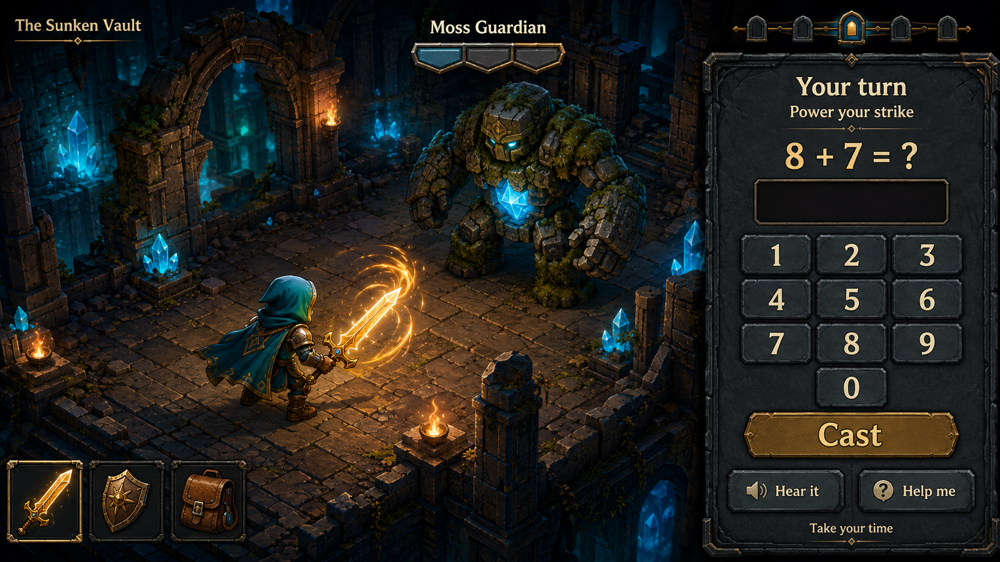
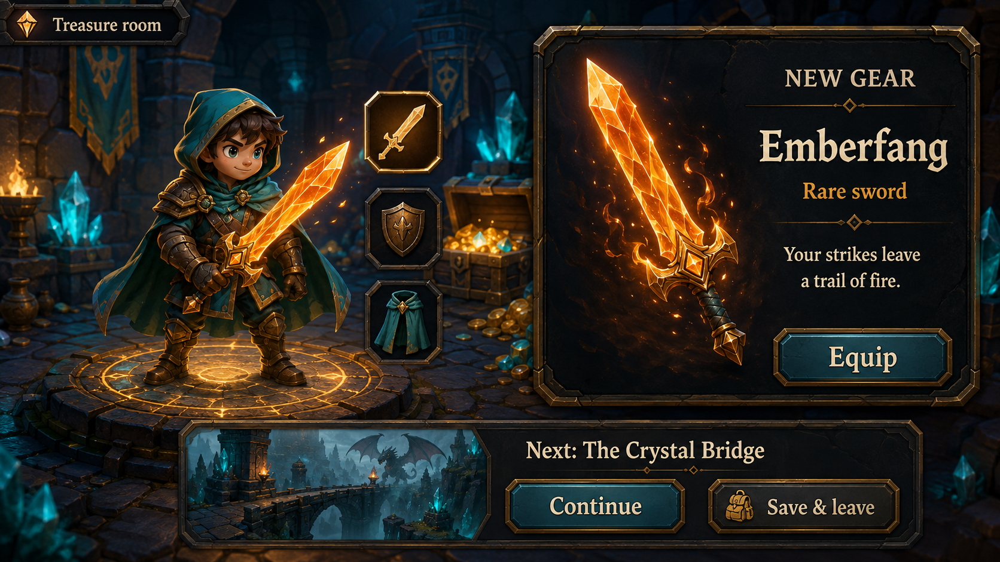
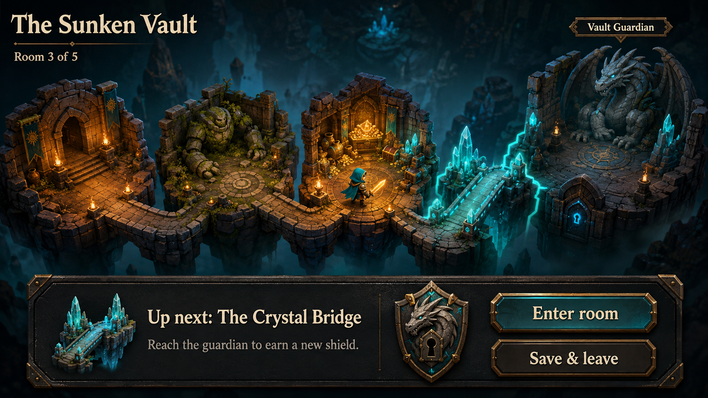

# The Sunken Vault: math dungeon RPG concepts

Three concept images for a gameplay overhaul of Institute. The working name is illustrative. This branch contains art and design notes only; the game and tutor have not been changed.

## The idea

Solve a problem → unleash a satisfying attack → clear a room → discover gear → equip it and explore the next room. A short expedition has a visible boss and a specific reward to work toward. Daily quests can remain an optional bonus, but completing them no longer ends the adventure's reward progression.

The hypothesis to test with the child is whether discovering rooms and trying new equipment makes the next encounter interesting in its own right. These images cannot establish that he will enjoy the loop; a small playable expedition is the next useful experiment.

## 1. Combat waits for you

The hero walks into position automatically. One monster and one problem are active at a time. A correct answer triggers the equipped weapon's attack, then the scene settles before the next question. There is no movement, aiming, dodging, or countdown to manage. A segmented monster guard makes progress visible without a complicated damage calculation.

An incorrect answer keeps the encounter paused and offers the existing teaching support; a slower answer does not invite an enemy attack. Help opens strategy guidance and an “I'm not sure yet” worked-solution option. Keep assisted work distinct from independent success in the existing attempt flow. New topics still get their worked demonstration before combat questions begin.

Production UI needs a delete key, keyboard input, the existing answer range, spoken prompts, accessible focus states, and space for longer problem types. The image illustrates the visual hierarchy rather than a complete control specification.

## 2. Equipment worth trying

Gear visibly changes the hero and the next attack: a fire trail, a shield burst, or a chain of crystal sparks. Simple effects create anticipation without asking a six-year-old to compare stat tables. Rooms and bosses give persistent progress toward gear, including after daily quests finish. Start with fixed, authored rewards so the first expedition demonstrates the idea clearly.

Weapons change the presentation and encounter effects; they do not choose the math curriculum or bypass learning requirements. Save-and-leave is always available at checkpoints, with progress retained and no loss for returning another day.

## 3. An adventure on rails

One obvious path leads from entrance to encounter, treasure, bridge, and guardian. The child taps “Enter room”; the game handles traversal and camera movement. The dragon shield previews the expedition reward. Later expeditions can introduce new environments and enemy behaviors expressed through discrete turns, while keeping navigation simple.

## Keep the learning engine

| Existing behavior | RPG integration |
| --- | --- |
| Prerequisite graph and adaptive topic selection (`server/src/graph.ts`, `server/src/select.ts`) | The tutor selects the next problem; room themes and equipment do not force a particular operation. |
| Spaced review and interleaving (`server/src/review.ts`, `server/src/select.ts`) | Review answers power normal adventure actions and remain eligible for adventure rewards. |
| Recent-window mastery and topic-specific fluency (`server/src/mastery.ts`) | Preserve mastery rules. A future fluency challenge can focus on eligible facts; ordinary combat stays untimed. |
| New-topic demonstrations, spoken explanations, and worked solutions (`shared/src/index.ts`, `web/src/game/tutor.ts`) | Present the same teaching support through the combat help panel and pre-encounter demonstrations. |
| Prerequisite rescue (`server/src/rescue.ts`) | Struggling leads to a confidence-building problem with a paused encounter, preserving the current remediation behavior. |
| Validated problems, attempt history, and parent dashboard | Retain the tutor contracts and reporting when replacing the gameplay client. |

Exploration unlocks and curriculum unlocks should remain separate: clearing a room is adventure progress, while demonstrated learning remains the basis for skill progression. Speed remains relevant where existing topic fluency rules require it, without making real-time controls a prerequisite for play.

## Suggested first playable experiment

Build one five-room expedition, one hero, two enemy types, one boss, and three visibly different equipment rewards. Connect it to the existing tutor before expanding content. Observe whether he wants to try a newly earned item, whether he can navigate independently, and whether asking for help remains comfortable. Tune room length after observing actual play.

## Art provenance and verification

Generated with the built-in image generation tool. Exact prompts are saved in [prompts.md](prompts.md). All three PNGs were visually inspected for readable text, consistent art direction, coherent progression, and untimed combat. These are raster interface concepts, not production assets or tested interactive screens. No application code changed, so code tests were not required.
