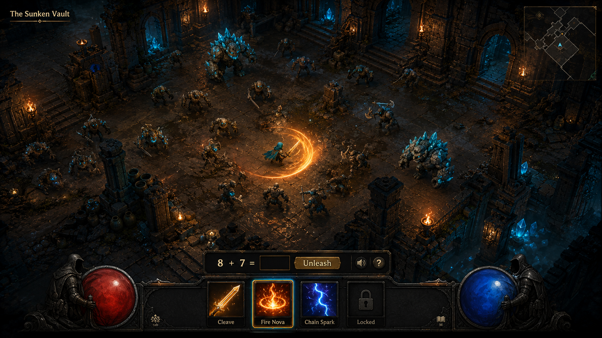
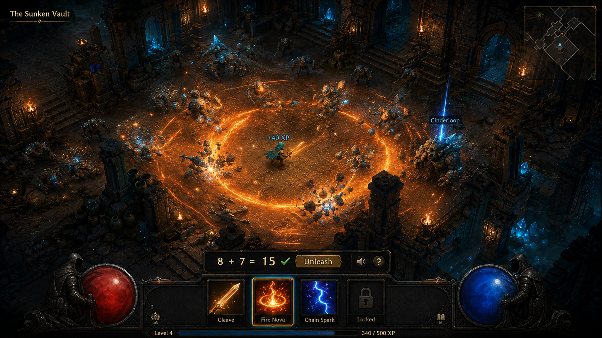
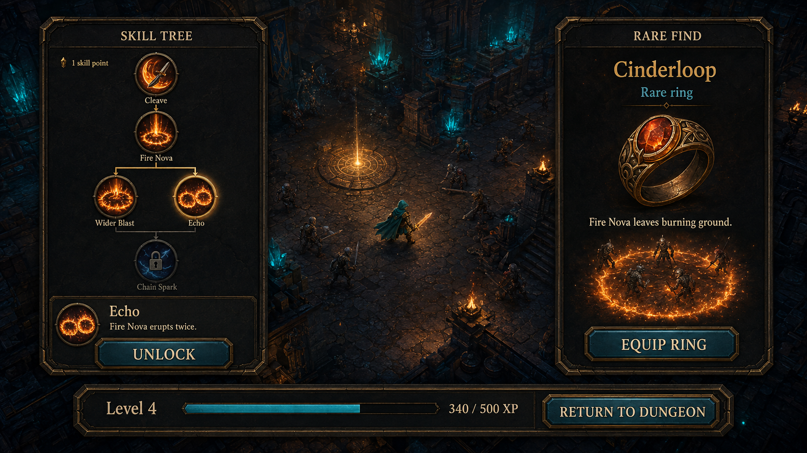

# Revision 2: horde combat, XP, and skill trees

Current concept direction following the user's feedback. Retain the original stone, teal-crystal, and amber-fire art direction; use a pulled-back Diablo-like viewport and a persistent character with levels, branching skills, unlockable spells, and rare equipment. These images and mechanics are proposals, not an implemented game.

## A living dungeon viewport

The hero stays small within a continuous dungeon. Packs of enemies surround the route, with brutes, ranged enemies, breakable scenery, and loot visible in the same view. The camera follows automatic movement through authored encounter waypoints. No movement, aiming, or dodging skill is required.

A compact answer strip sits above the ability bar. He can select an equipped spell or keep using his favorite; targeting and movement are automatic. The scene remains visible while answering. The desktop image assumes keyboard entry; a tablet implementation needs a collapsible number pad, delete control, and a larger layout for longer prompts and teaching support.

## Answers release the action

Each answer releases a short, choreographed burst: the hero dashes, cleaves several enemies, casts the selected spell, enemies react, and defeated enemies scatter loot. One problem can defeat a whole cluster. Tough enemies survive across multiple bursts, with changing formations and readable attacks.

Suggested rhythm for a prototype:

1. **Anticipation:** the next problem appears while the hero charges a spell and enemies prowl or hold wind-ups. Fire, capes, sparks, and ambient motion continue. Enemy damage, attack completion, projectiles, cooldowns, and encounter progress do not advance while he thinks. Pure slow motion would eventually punish a long answer; simulation must actually wait.
2. **Release:** a correct answer commits one action and plays roughly 1–3 seconds of combat at full speed. The chosen spell, equipment effects, and enemy reactions resolve together. No input is required during this animation.
3. **Flow onward:** the hero collects loot and advances automatically when the pack clears. The next problem appears at a safe anticipation point, without a battle-results modal after each group.

This creates an action-game presentation over discrete simulation steps. Presentation can remain lively indefinitely without changing the outcome based on answer speed. Help expands the existing tutor support; incorrect answers do not trigger an attack or reset the expedition. Assisted solutions keep the existing distinction from independent success in the learning records.

Cooldowns, shields, and damage-over-time effects use resolved actions, not elapsed seconds. A burning-ground ring therefore causes damage during releases, not while he reads. Health and focus orbs in the concept are visual placeholders: resource and failure rules still need playtesting, and waiting must never drain them.

## Character experience and levels

XP is persistent adventure progress from resolved encounters, with visible gains from defeated packs and bonuses at room or boss completion. Clearing content continues to award XP after daily quests finish. The XP bar previews the next level, and leveling grants a skill point in the initial design.

The screenshots' +40 XP, level 4, and 340 / 500 XP are illustrative, not a balanced reward curve. The prototype should make the first spell unlock reachable during the first short expedition, then test the pace with the child. XP awards must persist once per resolved encounter; retries, reloads, repeated submissions, or requesting help cannot duplicate them. Using help should still allow adventure completion and its reward.

Character level never substitutes for math mastery. The existing tutor remains responsible for adaptive difficulty, prerequisite readiness, spaced review, interleaving, worked examples, and remediation. A powerful character still receives the problems appropriate to his learning needs. Stronger gear changes combat outcomes rather than multiplying mastery credit or forcing harder questions.

## Skill trees and builds

The concept shows a small, readable tree: Cleave leads to Fire Nova, which offers Wider Blast and Echo upgrades. Chain Spark previews a later unlock. The finished game can have a few themed trees, revealed gradually, with a small number of equipped abilities. Begin with one tree and a three-spell loadout to keep choices understandable.

| Unlock | What changes in the dungeon |
| --- | --- |
| Cleave | A sweeping weapon attack strikes several nearby enemies. |
| Fire Nova | A radial blast hits a surrounding pack. |
| Wider Blast | Fire Nova reaches enemies farther away. |
| Echo | Fire Nova erupts a second time during the same action release. |
| Chain Spark | Lightning jumps between separated enemies. |
| Cinderloop, a rare ring | Fire Nova leaves burning ground that deals damage on later action releases. |

Skill points make choices about how the hero fights. Rare items modify those choices: Echo plus Cinderloop gives a double eruption followed by persistent fire. Offer free respecs at checkpoints so he can experiment without permanently spoiling his character. Spell nodes should have short spoken descriptions and animated previews; the game tree is separate from the parent's curriculum graph.

The tree illustration explores node connections, not final prerequisites or balance. In particular, the joining lines above Chain Spark need an explicit either/both prerequisite rule in implementation. Numbers, resource costs, enemy health, skill-point cadence, and item interactions remain open balancing choices.

## Loot and reasons to explore

Keep weapons, armor, and rings, recognizable rarity colors, loot beams, and satisfying auto-pickup. Items should change silhouettes, attacks, or spell behavior as well as simple power values. Specific boss rewards provide a visible goal; rarer discoveries can create surprises along the way. Their pacing and drop rules are still to be designed.

The continuing motivations are learning a new spell, reaching the next level, choosing a skill upgrade, trying a gear combination, and discovering the next dungeon. Save progress at safe checkpoints and offer an easy exit without losing XP, skill points, or collected loot.

## First playable slice to test this direction

One continuous dungeon route with three packs and a boss, automatic traversal, the anticipation/release cycle, Cleave and unlockable Fire Nova, one branching upgrade choice, a working XP bar and level-up, and one rare ring. Connect to the existing tutor first. Evaluate whether bursts feel satisfying, whether the scene feels alive during longer answers, whether he understands the upgrade choice, and whether he wants to try the new ability after earning it.

## Art and verification

Generated and revised with the built-in image generation tool. Exact prompts and reference roles are in [prompts-v2.md](prompts-v2.md). All three images were visually inspected: the camera is pulled back, packs share a continuous battlefield, Fire Nova has a multi-enemy impact, and the progression screen shows XP, branching skills, and a spell-modifying rare item. Animation feel, legibility at target device sizes, and gameplay balance require a prototype. No application code was changed.
