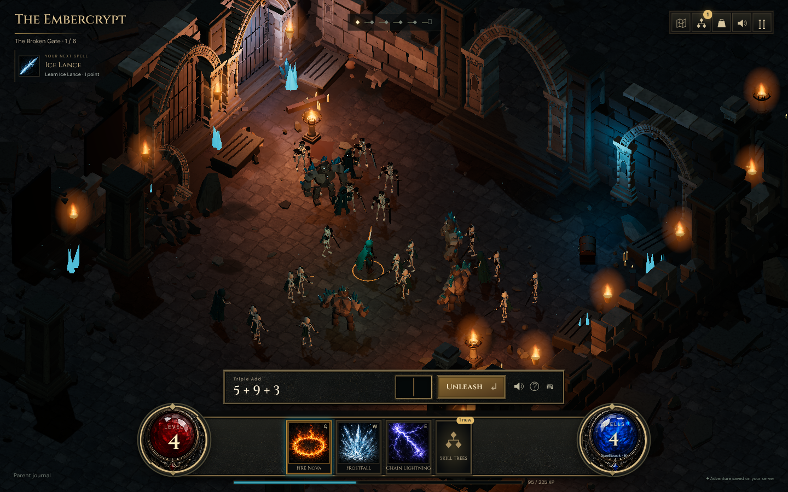

# The Sunken Vault playtest record

Verified September 5, 2026 on `concept/math-dungeon-rpg`. The second and third revisions address the gap between the first prototype and the approved concept: textured Gothic architecture, denser hordes, animated characters, illustrated controls, and substantially more magic and loot. Images below are captured from the implementation, not generated concept art.

## Third visual and progression pass

The subsequent pass adds rigid joint animation to skeletons and stone guardians,
including summoned guardians. Arms, knees, heads, weapons, and defeat fragments
now move independently while sharing instanced geometry. The vault gains small
broken vessels, candles, ironwork, scattered paving, and damp/grimy edges. Fire
spells use turbulent sheets and pooled moving fragments with contact flashes.

A chosen locked spell is now pinned at camp and in the dungeon. It names the next
missing prerequisite and calculates XP needed from the existing level curve;
learning it offers **Try it now**. Both free starter abilities are visible at the
first camp. Targets are stored per API/profile on the device, and never select
math problems or modify the learning graph.

This pass passes **210 unit tests**, the production build, all thirteen GLB
validators, the two gameplay regression scenarios, and the all-fifteen-spell
scenario. Added checks exercise exported joint transforms, independent cloned
poses, weapon parenting, defeat/reset, starter selection, learned-spell selection,
and pinned-spell reload with the exact pending question and unchanged mastery/XP.
The recovery scenario also passed (45.8 seconds), including committed-response loss during demonstrations, attempts, rewards, shields, skill upgrades, and next-question retrieval. All four browser scenarios pass on this revision.

The single-instance Chromium check rendered 26 articulated enemies in a 30-enemy
pack and 34 in a 39-enemy boss pack. Live full-quality samples varied roughly
31–51 FPS; the boss-cast capture measured 40 FPS. Screenshot capture and shader
warmup affect individual samples, so this is not a stable 60 FPS claim.
A real local boss solve completed with saved XP increasing from 410 to 500 and
new Ashsplitter loot. The actual Ares deployment is still not verified.

## Content and presentation

- **15 abilities** across Flame, Frost, and Storm, with distinct attack choreography and sound signatures. Fire Nova and Flame Cleave are available immediately; further spells unlock through the skill trees.
- **33 skill nodes** with prerequisite branches, multiple ranks, and visible modifiers such as repeated meteors, wider sweeps, orbiting lightning, and summoned guardians.
- **23 collectible relics**, including school-wide and spell-specific bonuses. Real drops have a rarity beam, a name label, and an illustrated discovery card with an Equip action.
- Three replayable regions with different scenery. Enemies wait while the learner thinks; animation and elapsed time never cause damage or submit learning outcomes.
- Thirteen self-contained Blender GLBs with baked PBR materials. The hero has an eight-bone rig and idle, walk, cleave, and cast clips. Authoring files and retained bake atlases live under `scripts/blender`; production GLBs embed their textures.
- Illustrated spellbook and equipment art, a connected skill-tree view, saved favorite abilities for the three hotbar slots, and keyboard controls: Q/W/E, B for spellbook, K for skills.

## Second revision checks

- **205 unit tests passed**, zero failures, across server, shared, tooling, audio, and client tests. Production TypeScript and Vite build passed.
- **Two gameplay regression scenarios passed** on a fresh SQLite fixture: complete expedition, first-answer miss and successful retry, exact question resume, boss loot, level-up, skill unlock, equipment, next region, worked help, response recovery, and touch input. The new discovery-card Equip action also leaves XP and mastery unchanged.
- **One recovery scenario passed** with deliberately dropped committed tutor, reward, miss, and skill responses; reload during recovery; preserved adaptive next branch and thinking time; demonstrations; assisted progress; and no duplicate XP, shield consumption, or skill spending.
- **One expanded spellbook scenario passed**: all 33 skill nodes purchased through the UI, all 15 abilities cast through real tutor/reward endpoints over three expeditions, equipment modifiers checked, and spell favorites plus the exact pending question retained across three reloads.
- Real Chromium remote debugging on **9222** used for full-quality visual inspection, live casts, desktop dialogs, and a **390 × 844** phone layout with number pad. No horizontal overflow in the checked layouts.
- Final renderer smoke checked hero animation clips, spell completion, pack clearing, and actual-drop anchors. With shaders warmed at 1440 × 900, this machine measured approximately **55 FPS idle and 50–56 FPS** through Flame Cleave, Fire Nova, Tempest, and Frost Guardian. Earlier cold compilation caused noticeable stalls; uncommon shaders are now precompiled during loading. These are local measurements, not a guarantee on other hardware. Automatic quality scaling ignores paused menus and restores detail after sustained recovery, so a slow dialog or cold load does not leave the dungeon permanently reduced.
- All **13 Blender GLBs** pass structural, embedded-texture, UV, and animation validation. Generated images, original audio, and licensed fonts are bundled locally; no runtime image service is required.

## Save and learning compatibility

Fixtures begin with existing mastered and practicing topics, reviews, demonstrations, gems, and equipment. Tests verify additive RPG initialization, unchanged legacy records, database reopen, profile isolation, and the real existing tutor attempt/retry/skip routes. Old RPG spell, skill, and item IDs remain accepted; existing saves do not need rewriting. RPG progression does not select math topics or change mastery rules. Production still uses profile `sam`; testing uses separate profiles in temporary databases.

**Ares was not changed or verified:** its tailnet SSH policy denied access. Follow the [upgrade instructions](rpg-operations.md) using the current service working directory, database, environment, and proxy configuration. Local save-compatibility tests are not evidence of a completed Ares upgrade.

## Visual assessment and remaining work

Compare the [approved Fire Nova concept](concepts/math-dungeon-rpg/05-fire-nova.png) with the [implemented combat view](rpg-playtest/v3/fire-nova.png), and the [original prototype](rpg-playtest/encounter.png). The second and third revisions add substantial surface detail, creature animation, richer effects, and matching interface art. The largest remaining visual gaps are the angular creature silhouettes and the regular, clean stonework compared with the concept's weathered surfaces. Passing tests does not establish concept-art parity or whether a child will choose to keep playing.

The next visual/content assessment should use the playable build, especially creature motion, repeated expeditions, spell impact, and the time between desirable unlocks. Remaining production acceptance includes the actual Ares upgrade/resume check and the child's playtest. Hardware acceleration is needed for the intended presentation; software-rendered fault tests lower framebuffer resolution and disable shadows.
