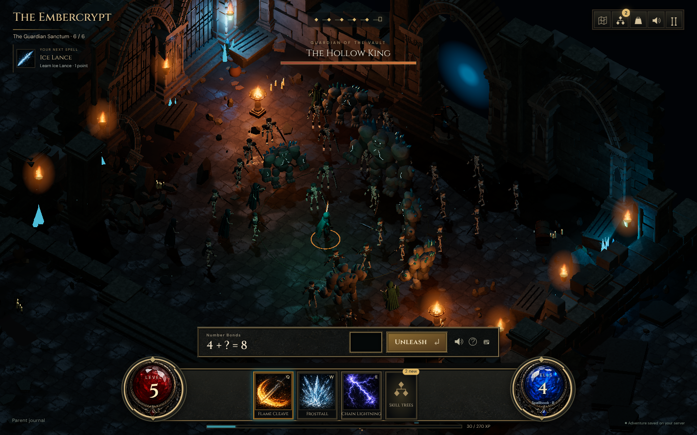

# The Sunken Vault playtest record

Verified September 5, 2026 on `concept/math-dungeon-rpg`. Successive revisions address the gap between the first prototype and the approved concept: textured Gothic architecture, denser hordes, animated characters, illustrated controls, and substantially more magic and loot. Images below are captured from the implementation, not generated concept art.

## Sixth room and composition pass

The six encounters now have distinct widths, wall heights, offset entrances, and
landmarks: the Broken Gate, Ember Hall, Lost Reliquary, Collapsed Crossing,
Crystal Gallery, and Guardian Sanctum. The furnace and reliquary were authored,
baked, and exported through Blender MCP. The crossing removes two actual floor
rectangles beside the bridge, with masonry extending down into the openings.
Floor stains, snow, and storm scenery respect those openings.

Enemy formations now fill clear spaces progressively. A normal 24–36-enemy horde
spreads across the room; later additions fill the gaps without rearranging the
existing formation. All rooms retain 96-enemy capacity. Placement excludes the
hero arrival area, incoming travel lane, room boundaries, and major landmarks.
This is floor-footprint clearance; large animated guardian arms may extend beyond it.

Tall architecture behind the hero cuts away after crossing the doorway, while the
floor stays visible. Torches and crystal landmarks anchor the four existing room
lights; restrained fill and irregular damp stone highlights improve separation.
The new models and runtime lighting are still checked against the approved
concept, rather than treating a passing regression as visual parity.

Live local play preserved the pending question across reload. Solving the bridge
and gallery advanced XP 596→628→660, reached level 5, and entered the larger
sanctum. Solving `4 + ? = 8` then completed the expedition, saved XP 660→750,
and awarded the legendary Phoenix Scepter. These were normal textbox/button
interactions in the user's Chromium profile on port 9222, using only the local
fixture learner. The final idle/cast lighting settings were first compared in
that renderer, then applied to the source.

The room checks include all 96 enemy footprints, progressive normal-pack spacing,
exact bridge floor coverage, transformed decal bounds, and sampled room-to-room
travel. The production library now contains 15 validated GLBs: 196,141 triangles
and 20,790,160 bytes, with 14 models loaded by gameplay (the retained wall asset
is not loaded). The unit suite passes 235 tests and the production build passes.
The two desktop/touch gameplay scenarios passed in 58.4 seconds. All 15 spell
abilities passed across three expeditions in 1.5 minutes, including equipment
modifiers, school effects, and persistent progression. The last changes after the
browser runs only remove duplicate doorway steps and reposition bridge torch
sockets; the final build/unit checks and renderer bridge inspection cover those. Landmark
light intensities were then reduced after their final renderer inspection; the
production build also passes with those adjustments.

The furnace, reliquary, and bridge images below are **renderer-only inspections**
at the normal camera with the HUD hidden; they are not additional recorded solves.
Another local tab advanced the fixture during testing, so these checks deliberately
left its learning and RPG save intact. The two new models were also re-imported
from their optimized GLBs and [inspected in Blender](../scripts/blender/previews/v2/room-landmarks.png).

Remaining visual work includes stronger fractured planes on the guardian bodies
and more grounded, textured spell impacts. The current revision improves room
variety and readability; it does not establish concept-art parity, sustained
child play appeal, or compatibility with the actual Ares deployment. Ares data
and services have not been modified.

## Fifth creature pass

Guardians now have closed, rounded fracture masses, a hunched silhouette, heavy
forearms, and crystals growing through their shoulders and backs. Skeletal
soldiers have thicker limbs, curved helmets, cupped shoulder caps, and pitted
armor. Close-up review prompted a second revision of overly rounded stone faces
and overly glossy shoulder shapes. See the [final exported creature review](../scripts/blender/previews/v2/creatures-rebuilt.png),
rendered in Blender after re-importing the optimized production GLBs.

The guardian's parts have explicit joint ownership and authored pivots. A
subagent reviewed their attachments, including shoulder crystals and forearm
glow. Chromium checks inspected the enlarged windup pose and normal horde view.
Both summoned guardians appeared and their effect completed; this renderer-only
check did not mutate learning or saved RPG progress.

A real local solve of `3 + 14 + 2 = 19` cast Flame Cleave, saved XP from 564 to
596, and dropped the epic Starfall Edge. The next problem remained `14 + 3 + 1`
after reload. All 210 unit tests pass against the final exported models,
including joint transforms and independent actor poses; all thirteen GLBs pass
validation (185,049 triangles, 18,754,444 bytes). The production build passes.
The all-fifteen-spell scenario passed over three expeditions in 2.0 minutes with
the new creature shapes; final surface/armor adjustments were followed by the
live Cleave, windup, summon, and exported-geometry checks described above.

The silhouettes are closer to the intended chunky dungeon creatures. Overall
scene variety, composition, and sustained play appeal still need assessment;
this pass does not establish concept-art parity or verify the Ares deployment.

## Fourth masonry pass

The rendered walls now combine chipped convex stones with a seamless limestone
surface baked through Blender MCP. Albedo, relief, and roughness use separate
maps; texture scale stays consistent across blocks, tombs, and stairs. Low courses
have damp darkening. Blender wall bays and broken-wall sections were rebuilt with
less regular courses, deeper edge wear, and mineral staining. The retained wall
asset was refreshed too, although the renderer does not currently load it.

Review caught and fixed collapsed UVs on some upper facets and encounter changes
restoring the old dark fallback tint. A geometry probe checked 4,400 chipped-stone
triangles and representative stair/slab geometry without collapsed UV triangles.
Live presentation checks confirmed the loaded surface and correct tint in all
three regions. The real local solve `7 + 10 + 1 = 18` cast Fire Nova, advanced to
the next encounter, and saved XP from 532 to 564.

The production build, 210 unit tests, and thirteen GLB validators pass. The two
desktop/touch gameplay regression scenarios passed in 57.5 seconds; the final UV
and tint fixes were then checked with a fresh build, geometry review, and live
Chromium play. The exported GLBs total 181,575 triangles and 19,003,348 bytes,
excluding the three new seamless maps. A warmed 120-frame observation at
1440 × 900 took 3.39 seconds (about 35 FPS); the cast diagnostic sampled 40 FPS.
Individual screenshot/cold-load samples were slower. This pass improves visible
stonework, but creature silhouettes and the overall composition still trail the
approved concept. Ares resume verification and a child's playtest remain pending.

## Third visual and progression pass

The subsequent pass adds rigid joint animation to skeletons and stone guardians,
including summoned guardians. Arms, knees, heads, weapons, and defeat fragments
now move independently while sharing instanced geometry. The vault gains small
broken vessels, candles, ironwork, scattered paving, and damp/grimy edges. Fire
spells use turbulent sheets and pooled moving fragments with contact flashes.

A chosen locked spell is now pinned at camp and in the dungeon. It names the next
missing prerequisite and calculates XP needed from the existing level curve;
learning it offers **Try it now**. Both free starter abilities are visible at the
first camp. Targets are stored per API/profile on the device, and never select
math problems or modify the learning graph.

This pass passes **210 unit tests**, the production build, all thirteen GLB
validators, the two gameplay regression scenarios, and the all-fifteen-spell
scenario. Added checks exercise exported joint transforms, independent cloned
poses, weapon parenting, defeat/reset, starter selection, learned-spell selection,
and pinned-spell reload with the exact pending question and unchanged mastery/XP.
The recovery scenario also passed (45.8 seconds), including committed-response loss during demonstrations, attempts, rewards, shields, skill upgrades, and next-question retrieval. All four browser scenarios pass on this revision.

The single-instance Chromium check rendered 26 articulated enemies in a 30-enemy
pack and 34 in a 39-enemy boss pack. Live full-quality samples varied roughly
31–51 FPS; the boss-cast capture measured 40 FPS. Screenshot capture and shader
warmup affect individual samples, so this is not a stable 60 FPS claim.
A real local boss solve completed with saved XP increasing from 410 to 500 and
new Ashsplitter loot. The actual Ares deployment is still not verified.

## Content and presentation

- **15 abilities** across Flame, Frost, and Storm, with distinct attack choreography and sound signatures. Fire Nova and Flame Cleave are available immediately; further spells unlock through the skill trees.
- **33 skill nodes** with prerequisite branches, multiple ranks, and visible modifiers such as repeated meteors, wider sweeps, orbiting lightning, and summoned guardians.
- **23 collectible relics**, including school-wide and spell-specific bonuses. Real drops have a rarity beam, a name label, and an illustrated discovery card with an Equip action.
- Three replayable regions with different scenery. Enemies wait while the learner thinks; animation and elapsed time never cause damage or submit learning outcomes.
- Fifteen self-contained Blender GLBs with baked PBR materials. The hero has an eight-bone rig and idle, walk, cleave, and cast clips. Authoring files and retained bake atlases live under `scripts/blender`; production GLBs embed their textures.
- Illustrated spellbook and equipment art, a connected skill-tree view, saved favorite abilities for the three hotbar slots, and keyboard controls: Q/W/E, B for spellbook, K for skills.

## Second revision checks

- **205 unit tests passed**, zero failures, across server, shared, tooling, audio, and client tests. Production TypeScript and Vite build passed.
- **Two gameplay regression scenarios passed** on a fresh SQLite fixture: complete expedition, first-answer miss and successful retry, exact question resume, boss loot, level-up, skill unlock, equipment, next region, worked help, response recovery, and touch input. The new discovery-card Equip action also leaves XP and mastery unchanged.
- **One recovery scenario passed** with deliberately dropped committed tutor, reward, miss, and skill responses; reload during recovery; preserved adaptive next branch and thinking time; demonstrations; assisted progress; and no duplicate XP, shield consumption, or skill spending.
- **One expanded spellbook scenario passed**: all 33 skill nodes purchased through the UI, all 15 abilities cast through real tutor/reward endpoints over three expeditions, equipment modifiers checked, and spell favorites plus the exact pending question retained across three reloads.
- Real Chromium remote debugging on **9222** used for full-quality visual inspection, live casts, desktop dialogs, and a **390 × 844** phone layout with number pad. No horizontal overflow in the checked layouts.
- Final renderer smoke checked hero animation clips, spell completion, pack clearing, and actual-drop anchors. With shaders warmed at 1440 × 900, this machine measured approximately **55 FPS idle and 50–56 FPS** through Flame Cleave, Fire Nova, Tempest, and Frost Guardian. Earlier cold compilation caused noticeable stalls; uncommon shaders are now precompiled during loading. These are local measurements, not a guarantee on other hardware. Automatic quality scaling ignores paused menus and restores detail after sustained recovery, so a slow dialog or cold load does not leave the dungeon permanently reduced.
- All **13 Blender GLBs** pass structural, embedded-texture, UV, and animation validation. Generated images, original audio, and licensed fonts are bundled locally; no runtime image service is required.

## Save and learning compatibility

Fixtures begin with existing mastered and practicing topics, reviews, demonstrations, gems, and equipment. Tests verify additive RPG initialization, unchanged legacy records, database reopen, profile isolation, and the real existing tutor attempt/retry/skip routes. Old RPG spell, skill, and item IDs remain accepted; existing saves do not need rewriting. RPG progression does not select math topics or change mastery rules. Production still uses profile `sam`; testing uses separate profiles in temporary databases.

**Ares was not changed or verified:** its tailnet SSH policy denied access. Follow the [upgrade instructions](rpg-operations.md) using the current service working directory, database, environment, and proxy configuration. Local save-compatibility tests are not evidence of a completed Ares upgrade.

## Visual assessment and remaining work

Compare the [approved Fire Nova concept](concepts/math-dungeon-rpg/05-fire-nova.png) with the [implemented combat view](rpg-playtest/v5/flame-cleave.png), and the [original prototype](rpg-playtest/encounter.png). Subsequent revisions add surface detail, creature animation, richer effects, and matching interface art. Remaining visual gaps include the orderly architecture and repeated encounter staging compared with the concept's more varied ruins. Passing tests does not establish concept-art parity or whether a child will choose to keep playing.

The next visual/content assessment should use the playable build, especially creature motion, repeated expeditions, spell impact, and the time between desirable unlocks. Remaining production acceptance includes the actual Ares upgrade/resume check and the child's playtest. Hardware acceleration is needed for the intended presentation; software-rendered fault tests lower framebuffer resolution and disable shadows.
