# The Sunken Vault playtest record

Verified September 5, 2026 on `concept/math-dungeon-rpg`. Successive revisions address the gap between the first prototype and the approved concept: textured Gothic architecture, closer combat framing, animated characters, illustrated controls, and substantially more magic and loot. Images below are captured from the implementation, not generated concept art.

## Thirteenth pass — independent art gate, work in progress

The independent [art review](rpg-art-review-v13.md) scores every rendered art
category against the user's scale: 10 is AAA graphics and every category must
reach 8. The baseline is approximately 4.5 overall and **fails**. Individual
failures and missing evidence remain visible; improved code and passing tests
do not imply visual acceptance. The current wraith, Ball Lightning and skill
tree revisions are candidates awaiting review and further iteration.

Regional expeditions now prioritize undiscovered eligible relics of their own
school, while retaining first-reward, encounter, clear-count and legendary
gates. The map forecasts the next treasure, including duplicate rewards.
Existing receipts are replayed unchanged; this requires no save migration.

Skills now use illustrated connected nodes and a separate selected-skill
panel. Selecting a node is free; the Learn or Upgrade button spends the point.
Upgrade previews report actual extra targets for the current loadout and room,
including the 48-target limit and already-active modifiers. The underlying
learning trees, mastery and question selection are unchanged.

Current validation: the production build and 292 CPU tests pass. Desktop/phone
regressions passed in 1.2 minutes, saved-phase recovery in 1.1 minutes, and all
fifteen spells across three expeditions in 2.1 minutes. The phone test verifies
that selecting a rune spends nothing, opening Details exposes the learning
button, and Learn spends exactly one point. Twenty GLBs validate at 286,791
triangles and 31,365,188 bytes. These checks do not certify art quality.

The new [upgrade illustrations](rpg-skill-art-v3.md) scored 8 as source art.
Visible desktop skill-tree partial states reached 8 across all three schools;
phone trees and lower-node coverage also reached 8 after label refinements.
Phone detail illustrations also reached 8 after increasing their presentation
to 144 pixels. This scoped acceptance covers the reviewed skill menu only;
HUD, other menus, models, world and complete effects retain separate gates.
Ball Lightning v4 orb forms reached 8 in the desktop full-quality samples;
complete spell motion, contacts and responsive presentation remain unverified.
The runtime wraith remains 5. Structural experiments are isolated from the
reproducible runtime builder and have not been accepted or baked into the game.
No Ares service or child profile was modified.

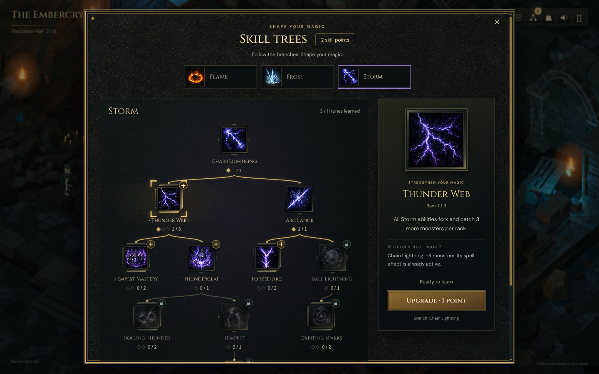
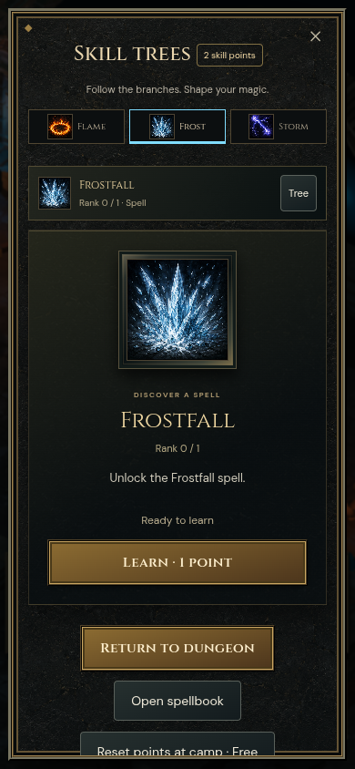

Completed enemy defeats now leave the instanced draw batches once their
existing visibility flag is false. Live and intermediate death-stage comparison
images are pixel-identical. A 40-enemy cleared room submits 824,152 fewer actor
triangles; its median GPU time changed from 37.6 to 32.8 ms in the same-browser
comparison. This does not improve the live-horde baseline or establish an
acceptable frame rate. New, retried and traveled encounters restore their full
instance counts.

Further diagnostics isolate most cost in the main scene pass, not bloom.
Measured GPU clocks were 750–800 MHz; the older 13 ms run has no clock evidence
and is not a comparable hardware-state baseline. No thermal cause was confirmed
and no power settings were changed. A point-light shader-branch experiment was
pixel-identical but did not improve performance, so it was not adopted.

The [corrected timing audit](rpg-playtest/v13/rpg-v13-audit-default.json) distinguishes
GPU timer queries, fence completion, CPU submission and animation callbacks.
The older benchmark's interpretation is corrected below.

## Twelfth closer combat and spell effects pass

The viewport is roughly **30% closer on desktop**, with nearly twice the actor
size on narrow phones. Short landscape views lift the hero above the question
dock and use a three-row number pad beside the action. The first unmodified
pack now has **14 enemies**, rising to 18 before a 24-enemy boss encounter;
spell, skill and equipment bonuses still contribute, with an authoritative
**48-enemy cap**. Small packs gather in loose groups around room anchors rather
than spreading single enemies across distant corners. Path, landmark, floor,
chasm and spacing constraints remain intact, including stable placement prefixes
through the old layout helper's 96-enemy capacity.

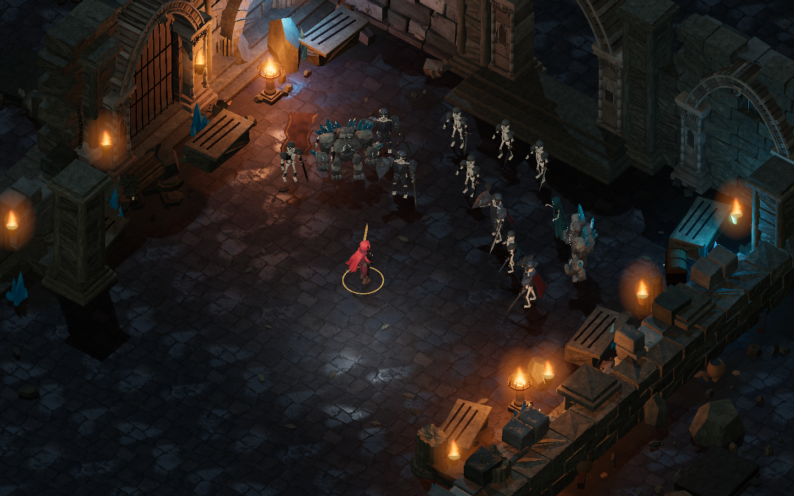

A dedicated effects agent rebuilt **Phoenix Dive** with bent flame shoulders,
separated curling feathers, curved tail trails, dark wisps and shedding embers.
The wing and tail roots follow the hero's actual animated position; visual review
caught and fixed the previous mismatch between the hero and effect clocks.
**Tempest and Blizzard** use broken asymmetric cloud strips and
sparse charged filaments in place of smooth funnel cylinders and luminous loops.
Lightning across the storm spells is now a thin jagged branching flash with a
faint blue corona and brief re-strikes. Chain Lightning's visible hops now match
its existing hit schedule, including maximum packs. Enemy hit times, cast
completion, learning and XP rules are unchanged.

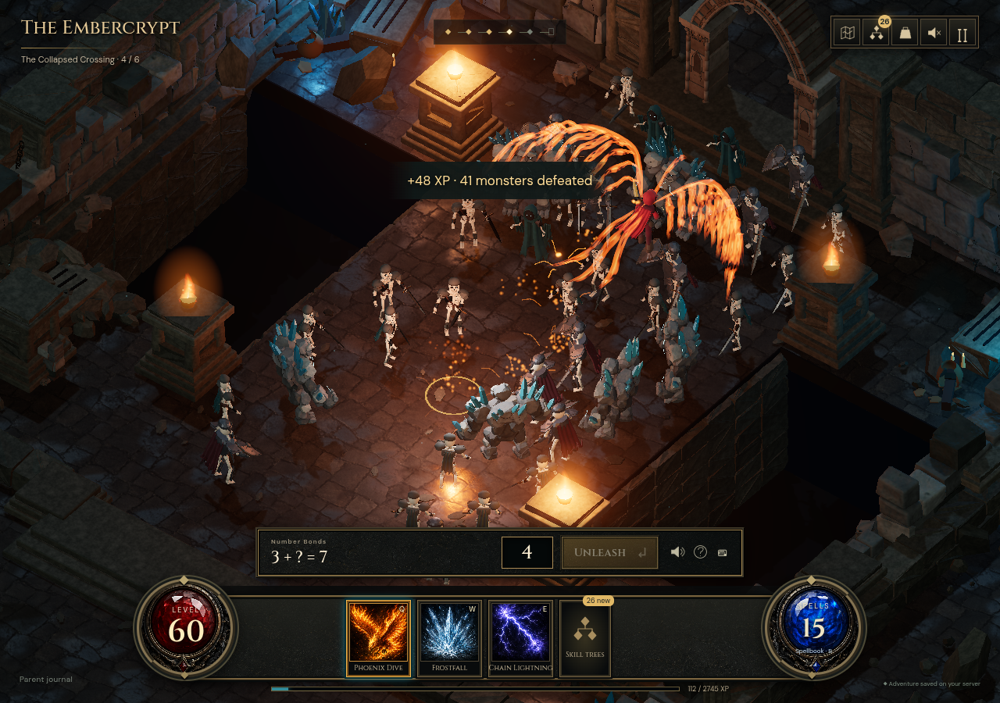
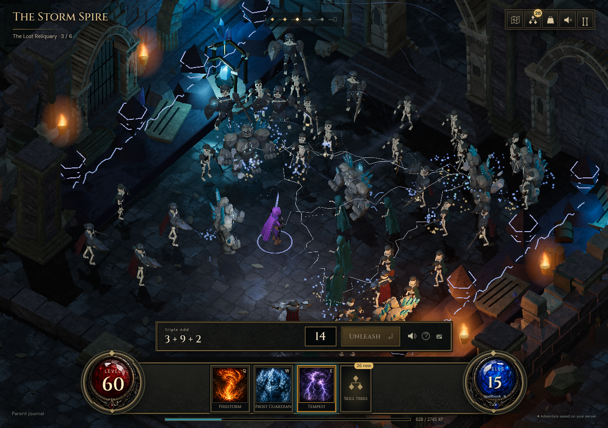

The new effects use bounded merged geometry, independent disposable materials,
conservative shader bounds and single-pass additive ribbons. Their shaders
compile during model loading. A second agent reviewed geometry, disposal,
orthographic facing and timing while the primary agent inspected actual casts.

The guardian received a Blender MCP material revision: darker weathered granite,
coarser grain and baked contact dirt. Geometry, joint hierarchy and animation
remain unchanged. Closed uneven mineral clusters replace glowing decorative
cones. A worn ceremonial runner now has fabric grain, faded borders, torn edges
and shallow folds instead of a conspicuous flat brown polygon. Independent art
review checked these against the approved viewport concept.

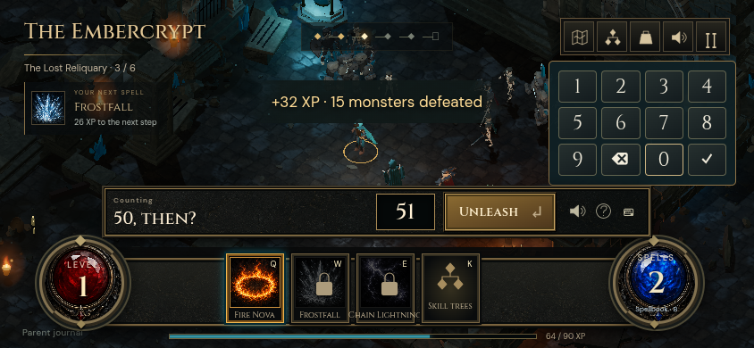

Validation: **280 unit tests pass**, the production build passes, and all 20 GLBs
validate at 282,913 triangles and 31,153,696 bytes. All 15 spells passed across
three actual expeditions in 2.4 minutes, including skills, equipment modifiers,
armor/favorites reloads, exact question recovery and duplicate boss rewards.
Both desktop/touch regressions passed in 1.4 minutes. A further focused touch
run passed in 18.2 seconds, checking actual landscape keypad clicks after
closing the relic card. Tutor fixtures use deterministic local fallbacks;
they do not exercise a live language-model service.

Compatibility tests replay a pre-change 24-kill receipt without rewriting it or
awarding again, then verify that the next encounter uses the smaller count.
Mastery, learning-tree selection, reward XP, levels, unlocks, inventory and saved
history retain their existing rules. There is no save migration for this pass.
No Ares service or child profile was modified.

A trial screen-space occlusion pass was discarded after comparison because its
visible benefit was slight. The original v12 benchmark's 2.7–4.9 ms values
measured CPU submission, **not completed GPU rendering**: a subsequent audit
found that `gl.finish()` returned before measurable GPU completion in this
Chromium configuration. Those values must not be interpreted as frame rates.

The corrected v13 benchmark separates CPU work, GPU timer queries, explicit
fence completion and animation-frame cadence. A short 14-enemy diagnostic on
this machine measured approximately 13 ms GPU time, 18.8 ms median fence
completion and 56.6–59.6 animation callbacks per second. Simulation took
0.4–0.6 ms and enemy animation 0.1–0.2 ms. The graphics backend differed from
the v12 run; this does not isolate the cause of the older 50–66.7 ms frame
intervals or establish performance for larger packs or another machine.

The closer view and Phoenix silhouette improve readability and spectacle. The
concept still has more natural creature anatomy, richer stone detail and more
convincing surface shading. Tempest remains comparatively restrained between
flashes. Actual Ares resume, consistent performance on the child's device, and
whether the child chooses to keep playing remain acceptance work. The game goal
is still open. The horde image is a renderer inspection; spell and landscape
images come from real UI playtests.

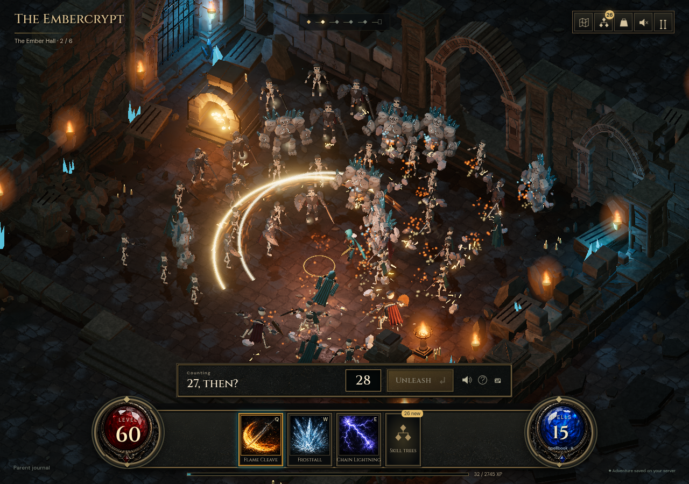

## Eleventh enemies and ruins pass

A new **armored revenant** adds a substantial shield-bearing silhouette between
lean skeletons and large guardians. Its dented asymmetric cuirass, layered
pauldrons, broken helm, ragged cloth, left shield and right sword were authored
through Blender MCP. It has 12 rigid joints, 13 mesh parts, 21,528 triangles and
a 2,041,016-byte self-contained GLB. The existing skeleton gained thicker ribs
and limb bones plus chipped armor; its height and foot grounding are unchanged.
Both final GLBs were reimported and rendered for review. The revenant sword tip
is 3.15cm above its lowest foot geometry, so normalization does not float it.

A deterministic presentation roster assigns about 35% of ordinary enemies to
revenants, with room-specific placement and varied stature. Guardian slots,
boss placement, authoritative enemy counts, reward calculations, XP and learning
rules are unchanged. Revenants have a slower gait, less bounce and a braced
shield pose. All enemy geometry remains instanced; individual joint transforms
still animate independently. The first 24-enemy pack contains 4 guardians,
7 revenants, 10 skeletons and 3 wraiths, with 21 articulated actors.

Partial arches, fallen fluted drums and jagged column stumps replace selected
intact wall details and the former full arch laid flat. Alternating foreground
pillars are lower fractured remnants, exposing more of the fight. New remnant
geometry has closed fracture caps, real fluting and individually closed arch
wedges. Transformed footprint checks preserve combat space, the travel lane,
landmarks, tombs, braziers, chests and crossing openings. Existing-pier replacements
retain their original footprint. Changing these constructions also changes
subsequent cosmetic masonry/rubble samples from the dungeon's deterministic
random stream; no save or learning data uses that stream.

The floor now has broad irregular dry deposits and damp worn patches. Their
cobble map, bump and roughness stay aligned to the original floor using world
UVs; a separate UV channel masks their broken edges and gaps. These flat surface
changes introduce no obstacles. Scenery adds two material batches per room
(14–15 total), retaining shared baked floor/stone textures and owning only its
two generated masks and 11 cloned/local materials.

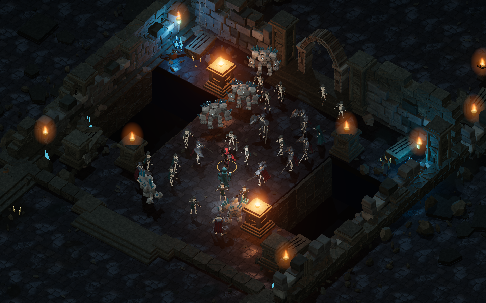

Short, separated moving sparks replace the conspicuous seven-spoke impact stars.
The actual Phoenix Dive capture below shows the revised contact effect while
retaining the spell's wing sweep, enemy defeat sequence and existing reward.

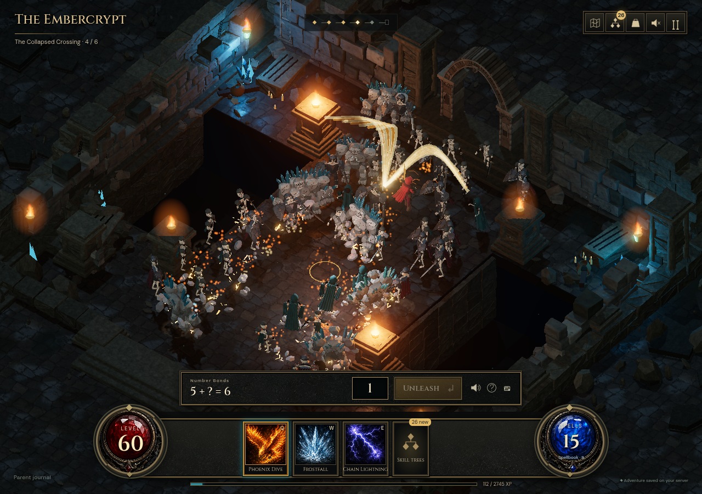

Validation: **255 unit tests pass** and the production build passes. Tests cover
roster count/determinism, the exported revenant's independent joint animation,
24 closed/wound remnant cases, footprint guards, registered floor UVs, mask
boundaries, texture ownership, and absence of scenery triangles spanning pits.
All 20 GLBs validate at 282,913 triangles and 31,176,536 bytes; 19 load at runtime.
The all-15-spell scenario passed in 2.2 minutes across three expeditions,
including armor/favorites/question reloads and relic effects.
Both desktop/touch regression scenarios passed in 1.2 minutes, including actual
revenant geometry in the renderer, legacy progress, full expedition rewards,
worked help, and lost-response recovery.

In Chromium on 9222, blocking only `revenant.glb` confirmed all seven first-room
knights fall back to animated skeletons. The block was then removed and normal
asset loading restored. The first implementation missed that fallback during
initial asset replacement; this is fixed. Review also fixed discarded authored
fracture colors on merged stumps. The new browser assertion requires actual
revenant geometry in attached instance batches, so a roster label alone cannot
pass the rendering check.

The horde and broken-architecture views were compared directly with the approved
viewport concept. Silhouette variety and fight visibility are stronger, while
the concept still has richer natural stone/creature detail and less geometric
effects. The normal-camera room and bridge captures are renderer inspections;
the Cleave/Phoenix captures come from real submitted test answers. No Ares service
or child profile was modified. Concept-art parity and the child's sustained
interest remain unproven.

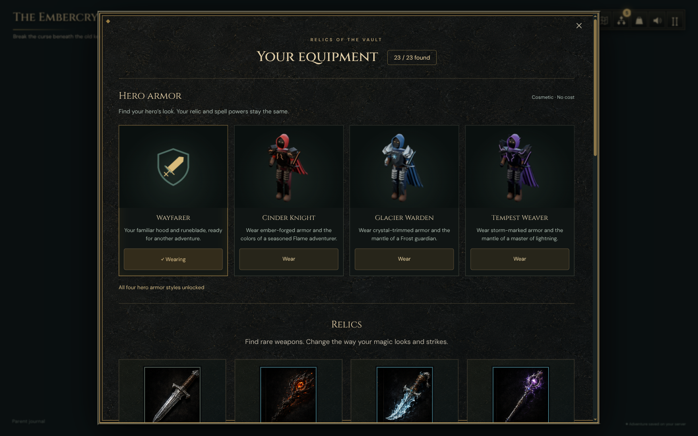

## Tenth armor and lighting pass

Three new Blender armor sets give later levels visible rewards: **Cinder Knight
at level 12, Glacier Warden at 15, and Tempest Weaver at 18**. Each changes the
hero's shoulder, chest, head and cape silhouette as well as color. They share
the original eight-bone rig, grounded dimensions, and idle/walk/cleave/cast clips.
Portraits are transparent renders of the final optimized runtime GLBs. Each
variant is 12,842–13,212 triangles and 2.00–2.11 MB. All 19 GLBs validate at
260,209 triangles and 29,026,312 bytes; the game loads 18 (the retained legacy
wall asset is not loaded).

Appearance selection is free and cosmetic. The additive `appearanceId` defaults
to Wayfarer for existing saves. `/rpg/appearance` validates the unlock against
persisted XP, preserves all other RPG state, and does not touch learning rows.
Reselecting the current armor does not rewrite the record. Unknown and locked
saved values safely normalize on read without rewriting old saves. There is no
schema migration, new currency, or change to the XP/learning curves.

The renderer clones each selected skeleton, restores the current transform and
animation time, reapplies the equipped weapon tint, and releases only the old
instance's skeleton and owned tint materials. Cached geometry and textures remain
available for later swaps. Missing optional appearance assets fall back to the
original animated hero. A dim prefiltered reflection environment and neutral
hero light reveal armor surfaces and reduce the former turquoise floor cast;
torches and moonlight still establish the room lighting.

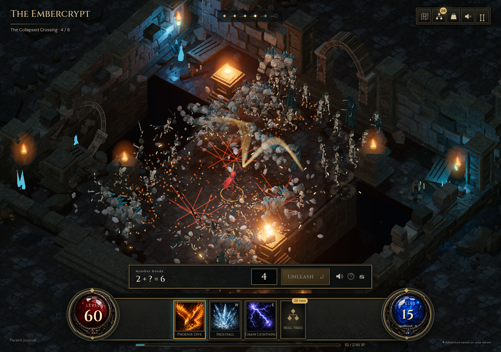

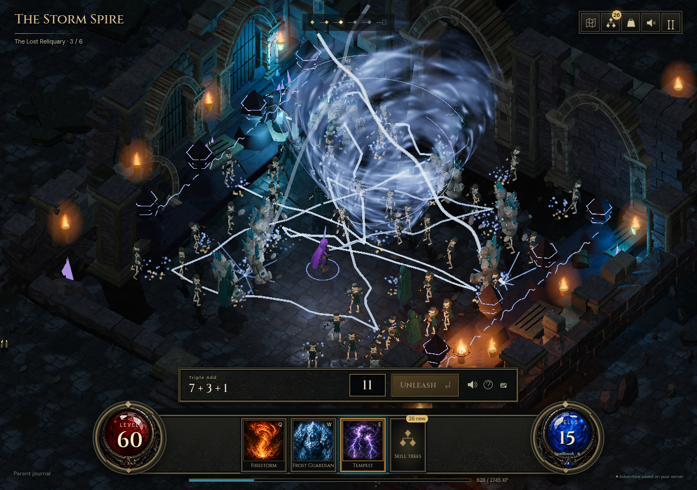

Validation: **248 unit tests pass**, the production build passes, and all asset
validators pass. The all-15-spell browser scenario passed in 2.3 minutes, wearing
all three variants at its reload checkpoints and verifying exact question,
mastery, XP, inventory, appearance, and four animation clips. Both desktop/touch
regression scenarios passed in 1.3 minutes, including legacy appearance defaults,
level locks, 390px equipment layout, retries, rewards, and response recovery.
The first browser pass caught portrait images overlapping Wear buttons; images
now stay within fixed responsive preview bounds, with an explicit regression
assertion. An ambiguous Equipment selector caused the other initial test failure
and was replaced with the exact accessible button name.

Chromium on port 9222 also verified real Wear-button persistence. A separate
renderer-only inspection sampled actual bone movement for all four clips on all
four appearances: each had eight bones, with 5–7 changing rotations in each
sample. These checks used isolated test profiles/databases; the son's progress
and Ares service were not changed.

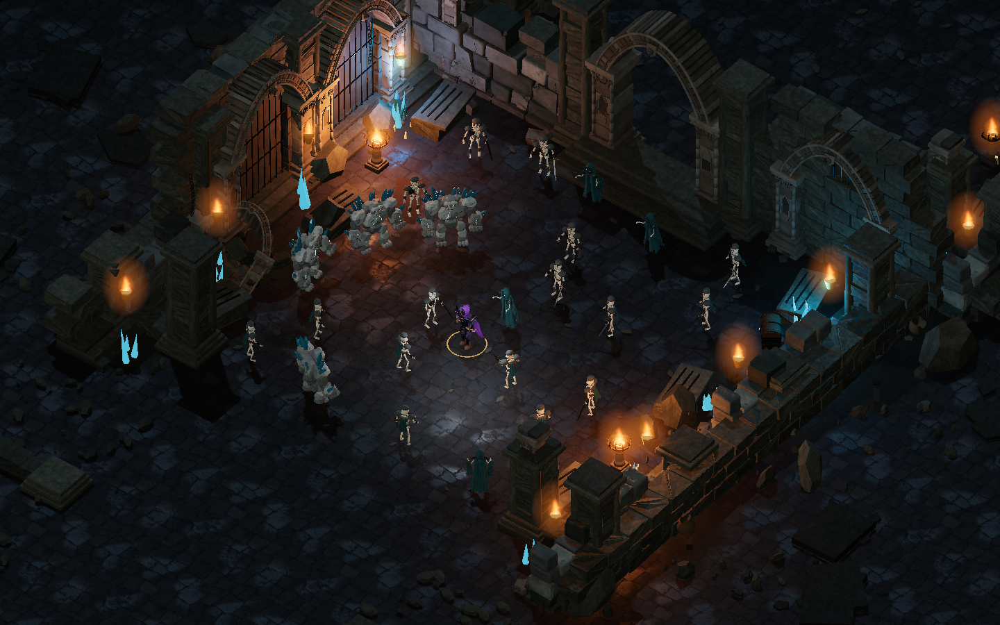

Comparing this view directly with the approved horde concept still shows thin
skeleton silhouettes, repetitive intact architectural trim, and less natural
material detail. The concept uses an active attack while this lighting sample is
idle, so spell quality is assessed separately in the actual answered-encounter
captures. This pass improves readability and late-level rewards; it does not
establish concept-art parity, long-term child engagement, or an Ares upgrade.

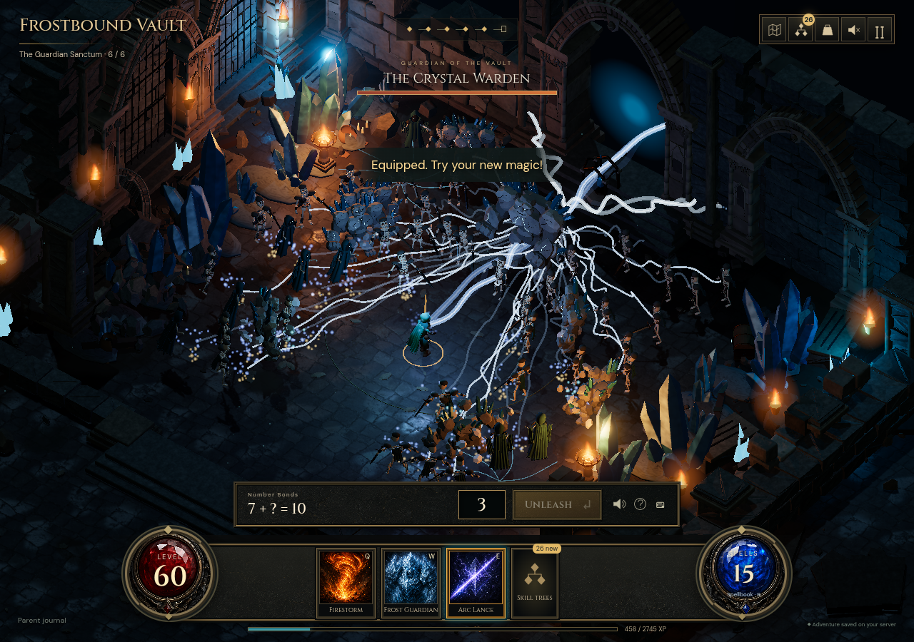

## Ninth stonework and relic pass

Broad faces of the runtime masonry now have real shallow depressions, while
their shared perimeter vertices remain closed. The Blender wall bay and broken
wall also gained coarse face/top relief and broader weathered normals. Their
original dimensions and grounding are unchanged; only those two GLBs were
rebuilt. They total 68,621 triangles and 4,496,120 bytes. The full 16-model library
validates at 220,953 triangles and 22,884,452 bytes.

Wall-foot rubble now forms asymmetric collapse piles with recognizable fallen
blocks, smaller fragments, grit and dirt. Two clusters per ordinary room sit
farther inward, between tomb rows. Transformed bounds exclude combat space,
travel lanes, landmarks, tombs, braziers, chests, and bridge openings for these
new substantial pieces. Scenery remains merged into 12–13 draws per room.

Scenery is rebuilt after bundled stone textures load, fixing clones that kept
the initial procedural fallback surfaces. Replacement disposes owned geometry,
materials, masks, and superseded procedural maps while retaining shared baked
textures. The room and bridge inspections in Chromium confirmed the new relief
and clear openings; these were **renderer-only checks** without submitted answers.

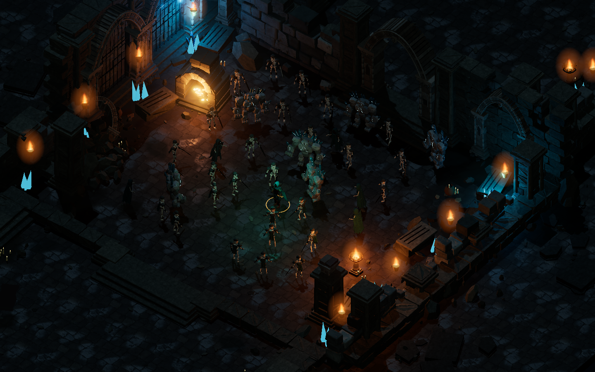

The item audit found and fixed two presentation bugs: Arc Fang's `pierce`
modifier was ignored by Arc Lance; it now adds two visible forward splinters.
The Staff of Endless Winter promised larger falling ice but only added an ice
wave; Frostfall's shard modifier now also enlarges its projectiles. The existing
damage counts, spell timing, XP, and loot rules are preserved.

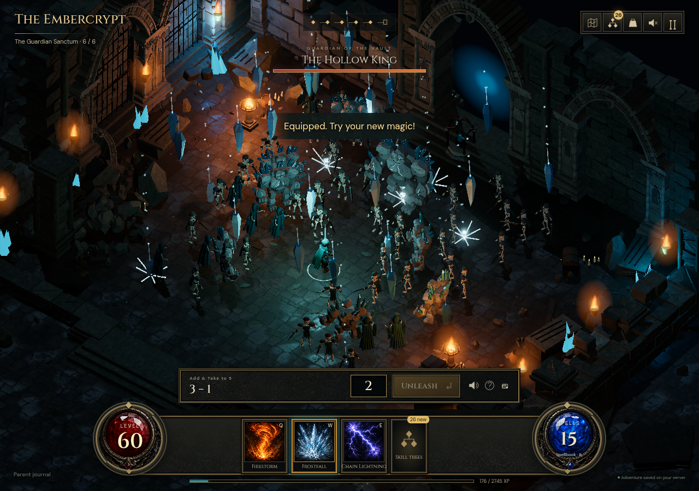

Duplicate boss relics now explicitly show their conversion into **16 bonus XP**
and the authoritative total XP for that guardian. Server behavior is unchanged:
the pre-existing literal 16 was extracted into a shared RPG constant so the
receipt explanation and reward calculation use the same value. There are no
learning-rule or save-format changes.

The production build and 241 unit tests pass, including masonry manifold checks
over 80 seeded size combinations. The all-15-spell browser scenario passed in
2.0 minutes with Arc Fang and Endless Winter equipped, three complete expeditions,
saved question/favorites reloads, and duplicate boss receipt/inventory assertions.
Both normal desktop/touch browser scenarios also passed in 1.1 minutes, covering
the legacy learner fixture, expedition rewards, retries, question resume,
worked help, and saved-response recovery.

For normal unassisted completions, the pacing audit found early spell opportunities at 3, 6, 11, 17, 23, and 30
answers, with final-school abilities first eligible at 60. Those are individual
earliest choices with prerequisite points reserved. All 15 abilities together
need at least 17 skill points (about 171 normal answers). The 22 nonstarter relics
are all discovered by answer 63, leaving a later gap in new item discoveries.
Potential follow-up is visible armor appearances at existing level milestones;
no new cosmetic system or pacing change is included here. Natural creature
surfaces, richer lighting, and the actual Ares resume check also remain open.

## Eighth fire, ice, and surface pass

Firestorm replaces intersecting flame cards with three unequal, bending volumes
per eruption. A first revision looked like solid orange leaves in Chromium;
the second adds transparent gaps, smaller hot veins, and rippling silhouettes.
Ember beds and ash remain close to the ground, leaving the enemies readable.

Ice projectiles now have closed fractured faces, asymmetric tips, contrasting
mineral facets, and fine trails. Glacial Surge grows leaning shards along
branching cracks rather than a regular grid of cones. Its placement respects
the room's usable floor and the bridge's openings when choosing shard centers. The same revised shards
also appear in Frostfall, Ice Lance, Blizzard upgrades, and Frost Guardian.

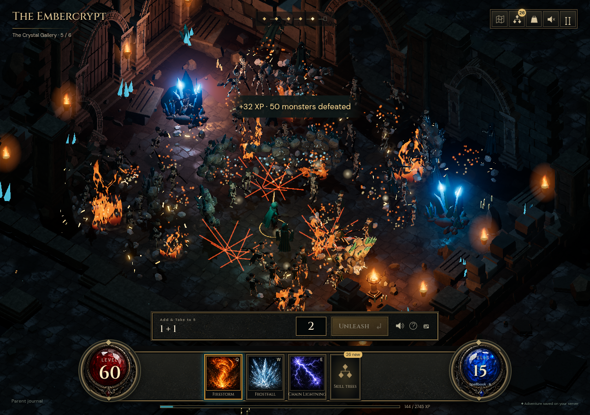
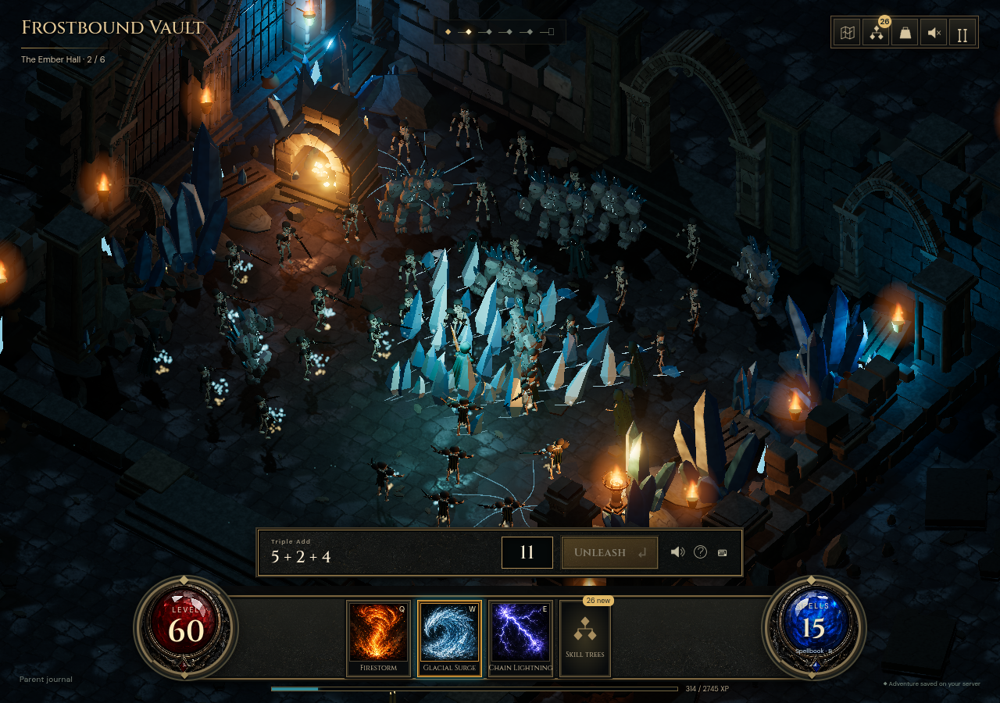

Blender MCP authored, baked, exported, and re-imported a five-shard ice cluster
for the frost region. The model has 1,380 triangles, one mesh, three embedded
maps, and a 369,300-byte GLB. Runtime scenery copies geometry and materials and
shares one set of copied textures within each biome; changing regions never
disposes the cached model's resources. Repeated ice meshes merge into a static
draw batch. The full library validates at 16 GLBs, 208,505 triangles, and
22,351,320 bytes; gameplay loads 15 of them.

The stone height bake now includes broader variation; albedo and roughness are
byte-identical to the prior version. An identical-camera Chromium A/B showed
only a subtle improvement at normal zoom, including a temporary stronger bump
experiment. Runtime bump strength remains unchanged. Broad wall-face relief,
more natural ruin detail, and more convincing creature surfaces remain visual
work; the surface rebake does not establish concept-art parity.

The production build and 239 unit tests pass. Four new geometry tests exercise
closed topology, outward winding, positive volume, finite normals, grounding,
and varying silhouettes across different seeds and dimensions. The screenshots
above use real tutor answers in a disposable fixture; the separate Chromium
9222 checks manually sampled the renderer and did not submit learning outcomes.
Learning rules, skill IDs, spell unlocks, XP, loot, and persisted save formats
were not changed. Ares remains untouched and unverified.

The all-spell browser scenario passed in 1.9 minutes, including all 33 skill
nodes learned through the UI, 15 distinct spell dispatches, equipment modifiers,
three completed expeditions, and exact pending-question/favorite reloads. The
changed fire and frost releases and the repeated school finales were visually
reviewed from the captured answers. These checks also cross from frost scenery
into the storm region after disposing the old biome.
Both normal desktop/touch gameplay scenarios passed in 1.0 minute, covering
expedition completion, pending-question resume, misses and retries, rewards,
skill learning, worked help, and saved-response recovery.

## Seventh creature and spell-impact pass

The guardian now has cut granite planes, sparse faults, and opaque quartz growths.
Blender MCP rebuilt and baked the asset, then re-imported the optimized production
GLB for inspection. Its ten animation joints and pivots match the previous model.
The library validates at 15 GLBs, 207,125 triangles and 21,982,020 bytes; the guardian
accounts for 24,570 triangles and 2,664,696 bytes.

Cleave now draws a curved blade trace with a narrow amber wake and tumbling sparks.
Fire contact bursts use short flashes and ground-skipping fragments. Meteor has
an irregular, opaque rock core, a tapered flame tail, directional debris, and low
ash and flame at impact. Its equipment-granted second impact is centered on the
second meteor's landing point. These changes preserve spell IDs, unlocks, rewards,
and answer timing.

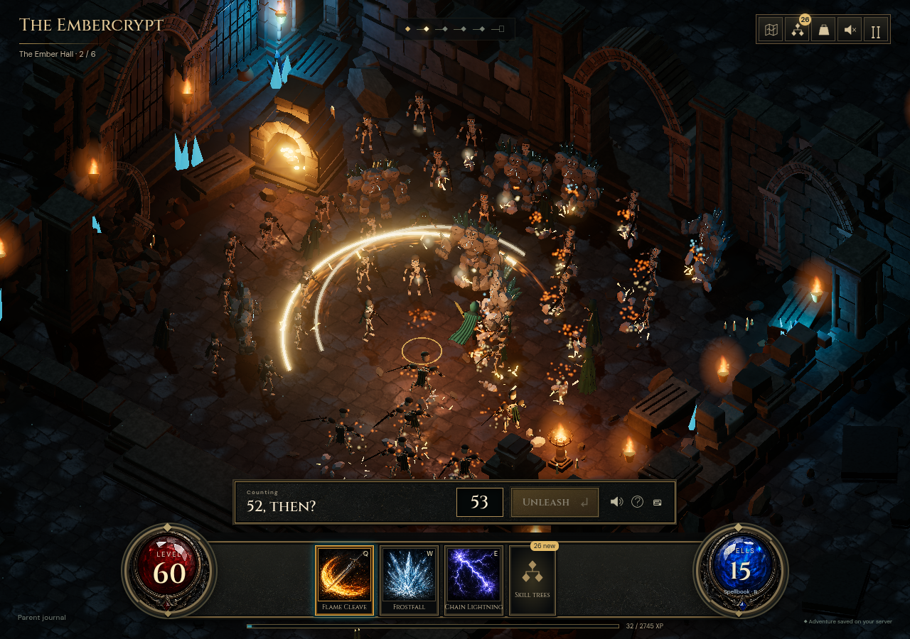
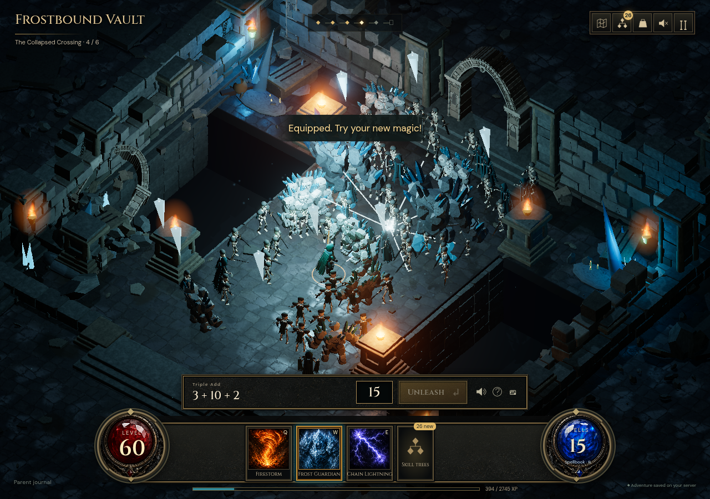

The screenshots above come from actual answers in an isolated local fixture.
The close-up below is a **renderer-only inspection** in the existing Chromium
9222 task tab, with the HUD hidden and camera zoomed. It does not represent an
additional solve or saved reward. The other local game tab and its save were left
alone.

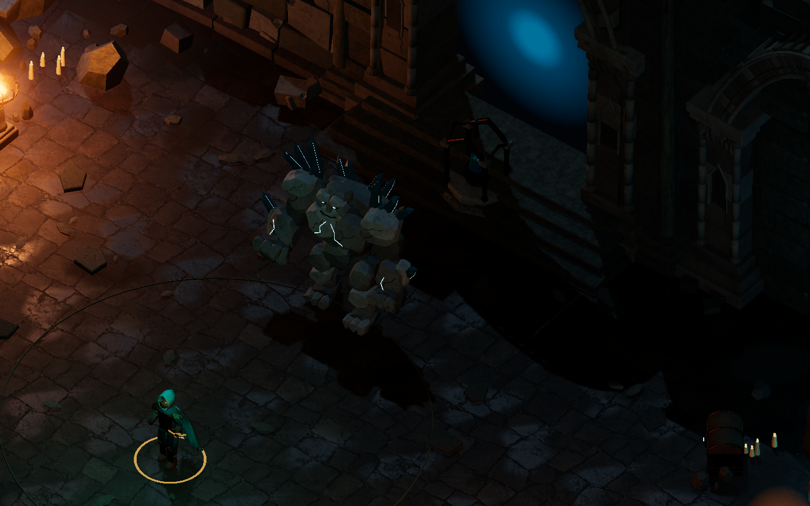

The spellbook test now requires a new attached effect during each cast; ambient
particles alone no longer satisfy it. Frost Guardian also checks the actual
number of attached summoned models. `RPG_CAPTURE_SPELLS=1` captures each spell
during release for manual review. Effect existence and dispatch assertions alone
do not establish that a spell looks distinctive or meets the concept's quality.

The production build and 235 unit tests pass. The all-spell browser scenario
passed in 1.9 minutes: all 33 nodes learned through the UI, all 15 abilities cast
over three completed expeditions, equipment modifiers applied, and favorites
plus the exact pending question preserved across reloads. All 18 cast captures
were visually reviewed, including the three repeated school finales. The offline
fixture intentionally uses the existing tutor's local fallback. Learning and
server source files were unchanged by this pass.
Both desktop/touch gameplay scenarios also passed in 1.0 minute, including
expedition completion, pending-question resume, retries, loot, skill learning,
worked help, and saved-response recovery.

Comparing these captures with the approved Fire Nova concept still reveals visual
gaps: Firestorm's upright flames, simple ice cones and regular spike rows, flat
wall surfaces, and the concept's denser rubble and more natural creature detail.
Those remain concrete follow-up work. Save compatibility with the actual Ares
deployment and sustained child play appeal are still unverified. No Ares data or
services were modified.

Issue tracking is unavailable in this checkout (`bd sync`: no beads database);
remaining work is recorded here.

## Sixth room and composition pass

The six encounters now have distinct widths, wall heights, offset entrances, and
landmarks: the Broken Gate, Ember Hall, Lost Reliquary, Collapsed Crossing,
Crystal Gallery, and Guardian Sanctum. The furnace and reliquary were authored,
baked, and exported through Blender MCP. The crossing removes two actual floor
rectangles beside the bridge, with masonry extending down into the openings.
Floor stains, snow, and storm scenery respect those openings.

Enemy formations now fill clear spaces progressively. A normal 24–36-enemy horde
spreads across the room; later additions fill the gaps without rearranging the
existing formation. All rooms retain 96-enemy capacity. Placement excludes the
hero arrival area, incoming travel lane, room boundaries, and major landmarks.
This is floor-footprint clearance; large animated guardian arms may extend beyond it.

Tall architecture behind the hero cuts away after crossing the doorway, while the
floor stays visible. Torches and crystal landmarks anchor the four existing room
lights; restrained fill and irregular damp stone highlights improve separation.
The new models and runtime lighting are still checked against the approved
concept, rather than treating a passing regression as visual parity.

Live local play preserved the pending question across reload. Solving the bridge
and gallery advanced XP 596→628→660, reached level 5, and entered the larger
sanctum. Solving `4 + ? = 8` then completed the expedition, saved XP 660→750,
and awarded the legendary Phoenix Scepter. These were normal textbox/button
interactions in the user's Chromium profile on port 9222, using only the local
fixture learner. The final idle/cast lighting settings were first compared in
that renderer, then applied to the source.

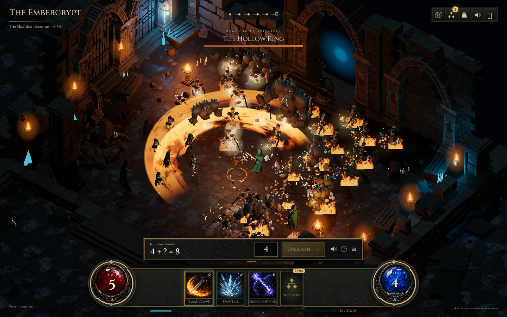

The room checks include all 96 enemy footprints, progressive normal-pack spacing,
exact bridge floor coverage, transformed decal bounds, and sampled room-to-room
travel. The production library now contains 15 validated GLBs: 196,141 triangles
and 20,790,160 bytes, with 14 models loaded by gameplay (the retained wall asset
is not loaded). The unit suite passes 235 tests and the production build passes.
The two desktop/touch gameplay scenarios passed in 58.4 seconds. All 15 spell
abilities passed across three expeditions in 1.5 minutes, including equipment
modifiers, school effects, and persistent progression. The last changes after the
browser runs only remove duplicate doorway steps and reposition bridge torch
sockets; the final build/unit checks and renderer bridge inspection cover those. Landmark
light intensities were then reduced after their final renderer inspection; the
production build also passes with those adjustments.

The furnace, reliquary, and bridge images below are **renderer-only inspections**
at the normal camera with the HUD hidden; they are not additional recorded solves.
Another local tab advanced the fixture during testing, so these checks deliberately
left its learning and RPG save intact. The two new models were also re-imported
from their optimized GLBs and [inspected in Blender](../scripts/blender/previews/v2/room-landmarks.png).

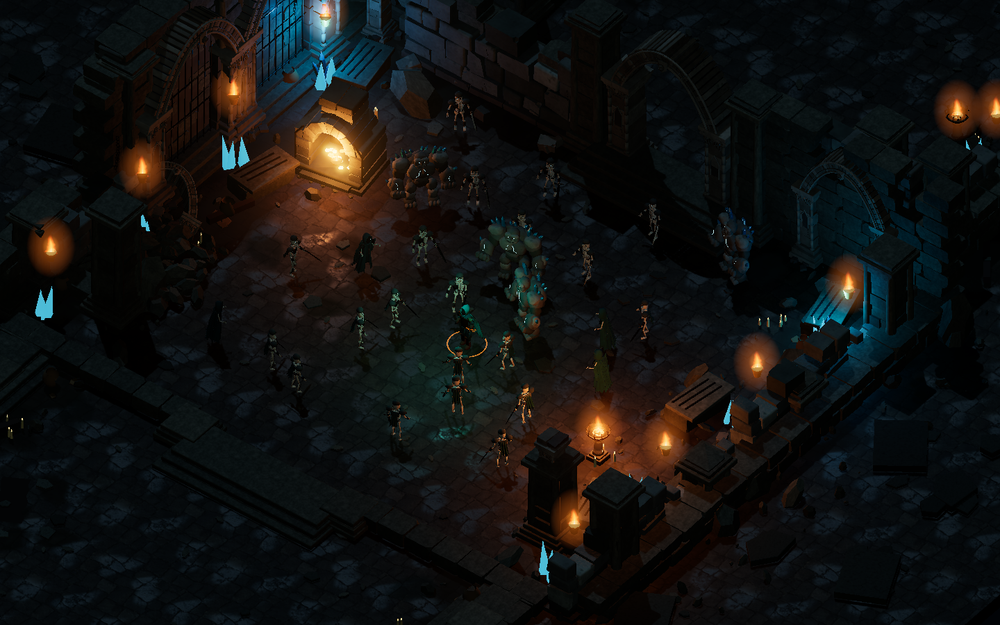
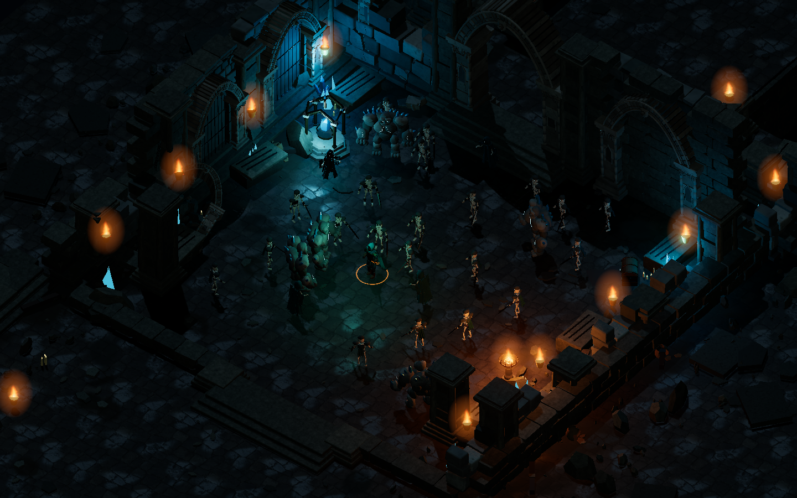
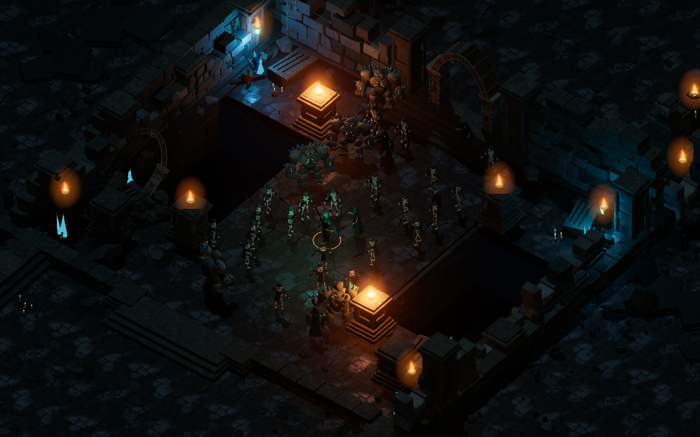

Remaining visual work includes stronger fractured planes on the guardian bodies
and more grounded, textured spell impacts. The current revision improves room
variety and readability; it does not establish concept-art parity, sustained
child play appeal, or compatibility with the actual Ares deployment. Ares data
and services have not been modified.

## Fifth creature pass

Guardians now have closed, rounded fracture masses, a hunched silhouette, heavy
forearms, and crystals growing through their shoulders and backs. Skeletal
soldiers have thicker limbs, curved helmets, cupped shoulder caps, and pitted
armor. Close-up review prompted a second revision of overly rounded stone faces
and overly glossy shoulder shapes. See the [final exported creature review](../scripts/blender/previews/v2/creatures-rebuilt.png),
rendered in Blender after re-importing the optimized production GLBs.

The guardian's parts have explicit joint ownership and authored pivots. A
subagent reviewed their attachments, including shoulder crystals and forearm
glow. Chromium checks inspected the enlarged windup pose and normal horde view.
Both summoned guardians appeared and their effect completed; this renderer-only
check did not mutate learning or saved RPG progress.

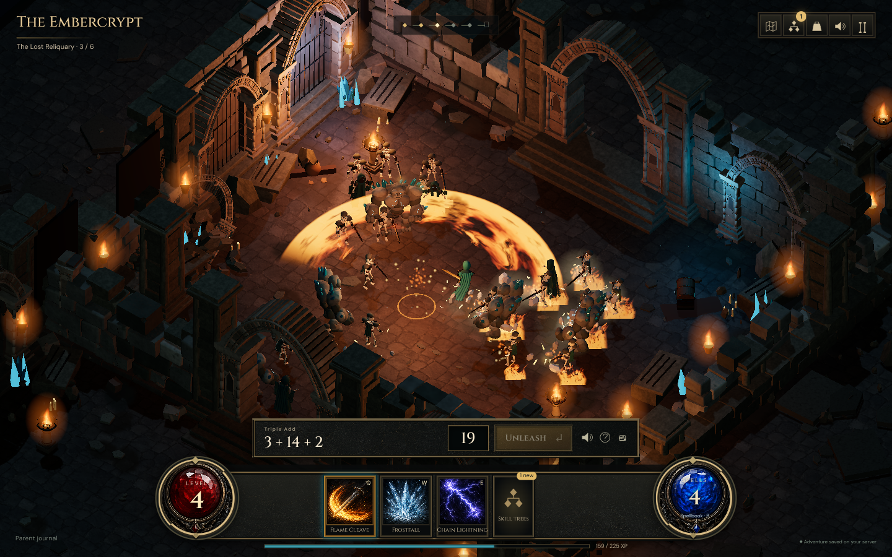

A real local solve of `3 + 14 + 2 = 19` cast Flame Cleave, saved XP from 564 to
596, and dropped the epic Starfall Edge. The next problem remained `14 + 3 + 1`
after reload. All 210 unit tests pass against the final exported models,
including joint transforms and independent actor poses; all thirteen GLBs pass
validation (185,049 triangles, 18,754,444 bytes). The production build passes.
The all-fifteen-spell scenario passed over three expeditions in 2.0 minutes with
the new creature shapes; final surface/armor adjustments were followed by the
live Cleave, windup, summon, and exported-geometry checks described above.

The silhouettes are closer to the intended chunky dungeon creatures. Overall
scene variety, composition, and sustained play appeal still need assessment;
this pass does not establish concept-art parity or verify the Ares deployment.

## Fourth masonry pass

The rendered walls now combine chipped convex stones with a seamless limestone
surface baked through Blender MCP. Albedo, relief, and roughness use separate
maps; texture scale stays consistent across blocks, tombs, and stairs. Low courses
have damp darkening. Blender wall bays and broken-wall sections were rebuilt with
less regular courses, deeper edge wear, and mineral staining. The retained wall
asset was refreshed too, although the renderer does not currently load it.

Review caught and fixed collapsed UVs on some upper facets and encounter changes
restoring the old dark fallback tint. A geometry probe checked 4,400 chipped-stone
triangles and representative stair/slab geometry without collapsed UV triangles.
Live presentation checks confirmed the loaded surface and correct tint in all
three regions. The real local solve `7 + 10 + 1 = 18` cast Fire Nova, advanced to
the next encounter, and saved XP from 532 to 564.

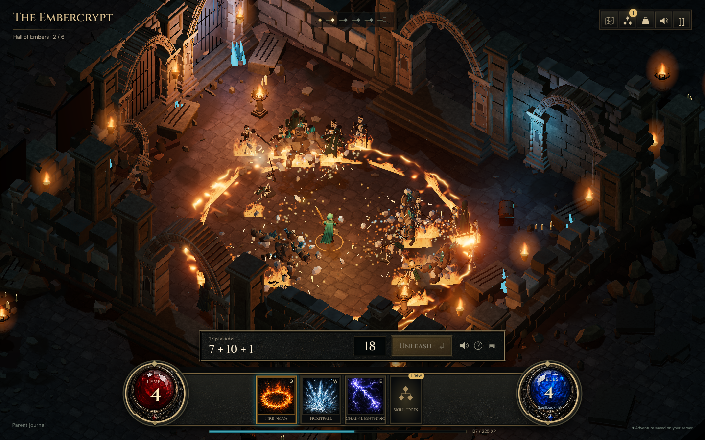

The production build, 210 unit tests, and thirteen GLB validators pass. The two
desktop/touch gameplay regression scenarios passed in 57.5 seconds; the final UV
and tint fixes were then checked with a fresh build, geometry review, and live
Chromium play. The exported GLBs total 181,575 triangles and 19,003,348 bytes,
excluding the three new seamless maps. A warmed 120-frame observation at
1440 × 900 took 3.39 seconds (about 35 FPS); the cast diagnostic sampled 40 FPS.
Individual screenshot/cold-load samples were slower. This pass improves visible
stonework, but creature silhouettes and the overall composition still trail the
approved concept. Ares resume verification and a child's playtest remain pending.

## Third visual and progression pass

The subsequent pass adds rigid joint animation to skeletons and stone guardians,
including summoned guardians. Arms, knees, heads, weapons, and defeat fragments
now move independently while sharing instanced geometry. The vault gains small
broken vessels, candles, ironwork, scattered paving, and damp/grimy edges. Fire
spells use turbulent sheets and pooled moving fragments with contact flashes.

A chosen locked spell is now pinned at camp and in the dungeon. It names the next
missing prerequisite and calculates XP needed from the existing level curve;
learning it offers **Try it now**. Both free starter abilities are visible at the
first camp. Targets are stored per API/profile on the device, and never select
math problems or modify the learning graph.

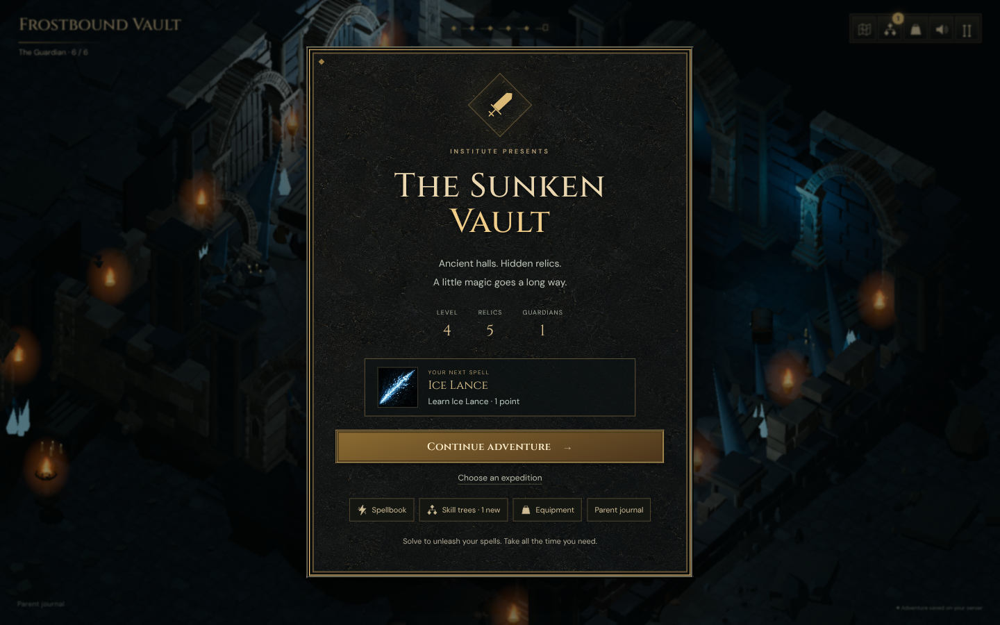

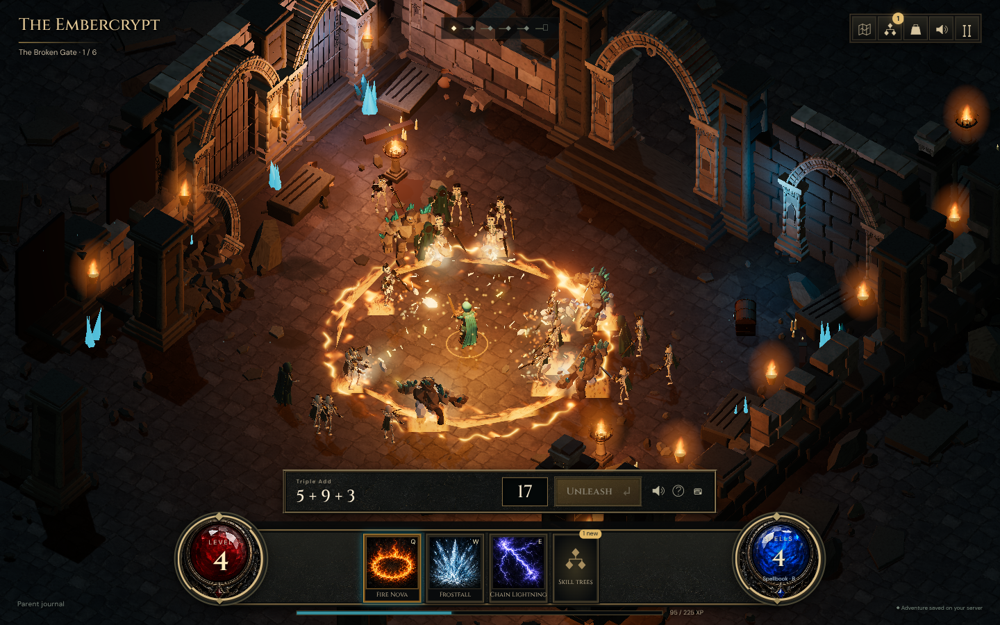

This pass passes **210 unit tests**, the production build, all thirteen GLB
validators, the two gameplay regression scenarios, and the all-fifteen-spell
scenario. Added checks exercise exported joint transforms, independent cloned
poses, weapon parenting, defeat/reset, starter selection, learned-spell selection,
and pinned-spell reload with the exact pending question and unchanged mastery/XP.
The recovery scenario also passed (45.8 seconds), including committed-response loss during demonstrations, attempts, rewards, shields, skill upgrades, and next-question retrieval. All four browser scenarios pass on this revision.

The single-instance Chromium check rendered 26 articulated enemies in a 30-enemy
pack and 34 in a 39-enemy boss pack. Live full-quality samples varied roughly
31–51 FPS; the boss-cast capture measured 40 FPS. Screenshot capture and shader
warmup affect individual samples, so this is not a stable 60 FPS claim.
A real local boss solve completed with saved XP increasing from 410 to 500 and
new Ashsplitter loot. The actual Ares deployment is still not verified.

## Content and presentation

- **15 abilities** across Flame, Frost, and Storm, with distinct attack choreography and sound signatures. Fire Nova and Flame Cleave are available immediately; further spells unlock through the skill trees.
- **33 skill nodes** with prerequisite branches, multiple ranks, and visible modifiers such as repeated meteors, wider sweeps, orbiting lightning, and summoned guardians.
- **23 collectible relics**, including school-wide and spell-specific bonuses. Real drops have a rarity beam, a name label, and an illustrated discovery card with an Equip action.
- Four hero appearances, including armor milestones at levels 12, 15, and 18, with persistent cosmetic selection.
- Three replayable regions with different scenery. Enemies wait while the learner thinks; animation and elapsed time never cause damage or submit learning outcomes.
- Twenty self-contained Blender GLBs with baked PBR materials. The hero has an eight-bone rig and idle, walk, cleave, and cast clips. Authoring files and retained bake atlases live under `scripts/blender`; production GLBs embed their textures.
- Illustrated spellbook and equipment art, a connected skill-tree view, saved favorite abilities for the three hotbar slots, and keyboard controls: Q/W/E, B for spellbook, K for skills.

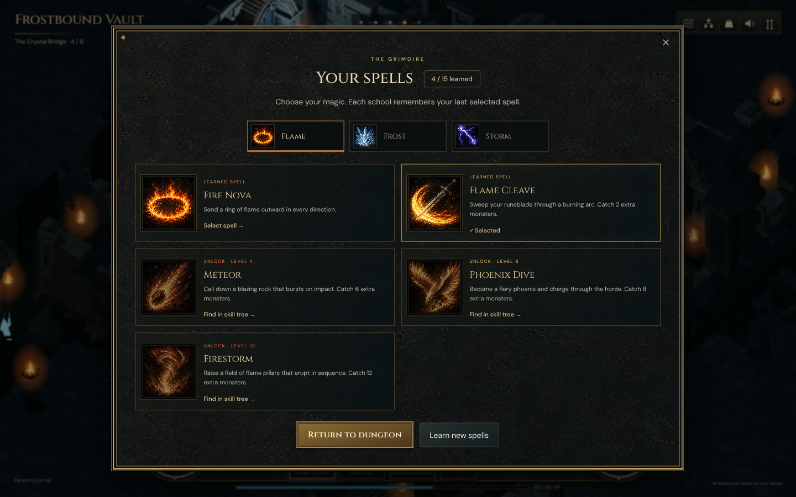

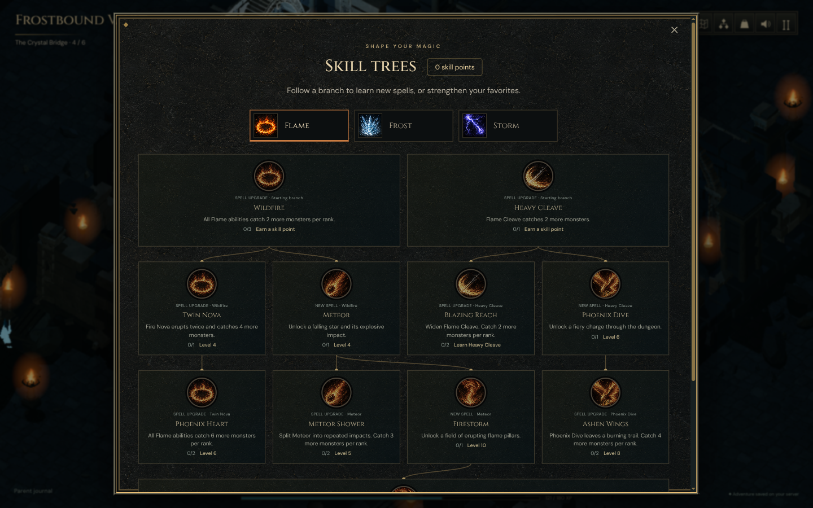

## Second revision checks

- **205 unit tests passed**, zero failures, across server, shared, tooling, audio, and client tests. Production TypeScript and Vite build passed.
- **Two gameplay regression scenarios passed** on a fresh SQLite fixture: complete expedition, first-answer miss and successful retry, exact question resume, boss loot, level-up, skill unlock, equipment, next region, worked help, response recovery, and touch input. The new discovery-card Equip action also leaves XP and mastery unchanged.
- **One recovery scenario passed** with deliberately dropped committed tutor, reward, miss, and skill responses; reload during recovery; preserved adaptive next branch and thinking time; demonstrations; assisted progress; and no duplicate XP, shield consumption, or skill spending.
- **One expanded spellbook scenario passed**: all 33 skill nodes purchased through the UI, all 15 abilities cast through real tutor/reward endpoints over three expeditions, equipment modifiers checked, and spell favorites plus the exact pending question retained across three reloads.
- Real Chromium remote debugging on **9222** used for full-quality visual inspection, live casts, desktop dialogs, and a **390 × 844** phone layout with number pad. No horizontal overflow in the checked layouts.
- Final renderer smoke checked hero animation clips, spell completion, pack clearing, and actual-drop anchors. With shaders warmed at 1440 × 900, this machine measured approximately **55 FPS idle and 50–56 FPS** through Flame Cleave, Fire Nova, Tempest, and Frost Guardian. Earlier cold compilation caused noticeable stalls; uncommon shaders are now precompiled during loading. These are local measurements, not a guarantee on other hardware. Automatic quality scaling ignores paused menus and restores detail after sustained recovery, so a slow dialog or cold load does not leave the dungeon permanently reduced.
- All **13 Blender GLBs** pass structural, embedded-texture, UV, and animation validation. Generated images, original audio, and licensed fonts are bundled locally; no runtime image service is required.

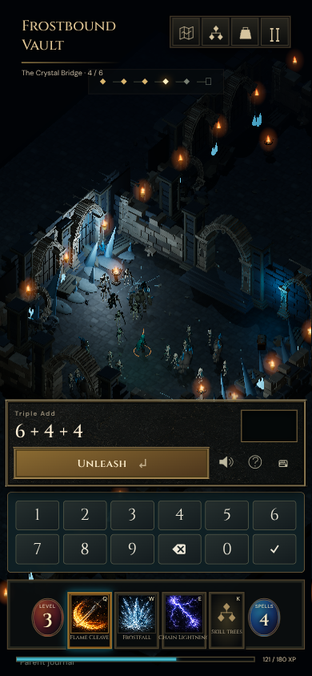

## Save and learning compatibility

Fixtures begin with existing mastered and practicing topics, reviews, demonstrations, gems, and equipment. Tests verify additive RPG initialization, unchanged legacy records, database reopen, profile isolation, and the real existing tutor attempt/retry/skip routes. Old RPG spell, skill, and item IDs remain accepted; existing saves do not need rewriting. RPG progression does not select math topics or change mastery rules. Production still uses profile `sam`; testing uses separate profiles in temporary databases.

**Ares was not changed or verified:** its tailnet SSH policy denied access. Follow the [upgrade instructions](rpg-operations.md) using the current service working directory, database, environment, and proxy configuration. Local save-compatibility tests are not evidence of a completed Ares upgrade.

## Visual assessment and remaining work

Compare the [approved Fire Nova concept](concepts/math-dungeon-rpg/05-fire-nova.png) with the [implemented combat view](rpg-playtest/v7/meteor.png), and the [original prototype](rpg-playtest/encounter.png). Subsequent revisions add surface detail, creature animation, richer effects, distinct room layouts, and matching interface art. Remaining visual gaps include geometric effects, repeated wall surfaces, and the concept's more natural creature anatomy and material detail. Passing tests does not establish concept-art parity or whether a child will choose to keep playing.

The next visual/content assessment should use the playable build, especially creature motion, repeated expeditions, spell impact, and the time between desirable unlocks. Remaining production acceptance includes the actual Ares upgrade/resume check and the child's playtest. Hardware acceleration is needed for the intended presentation; software-rendered fault tests lower framebuffer resolution and disable shadows.
