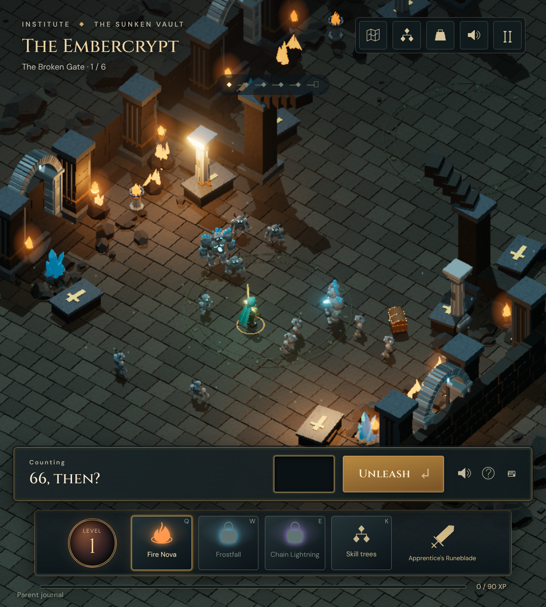
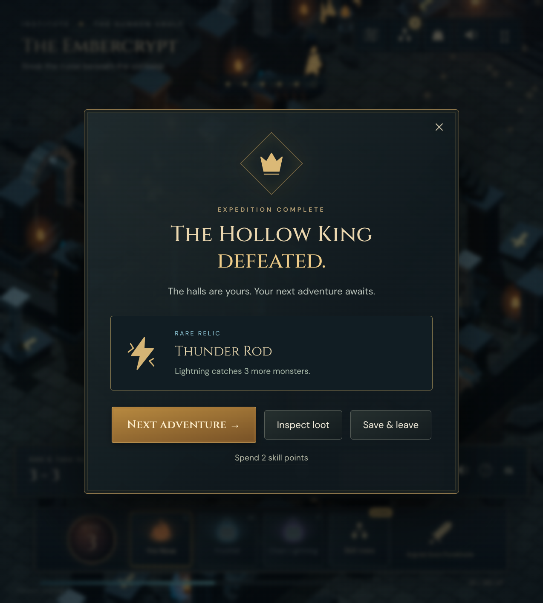
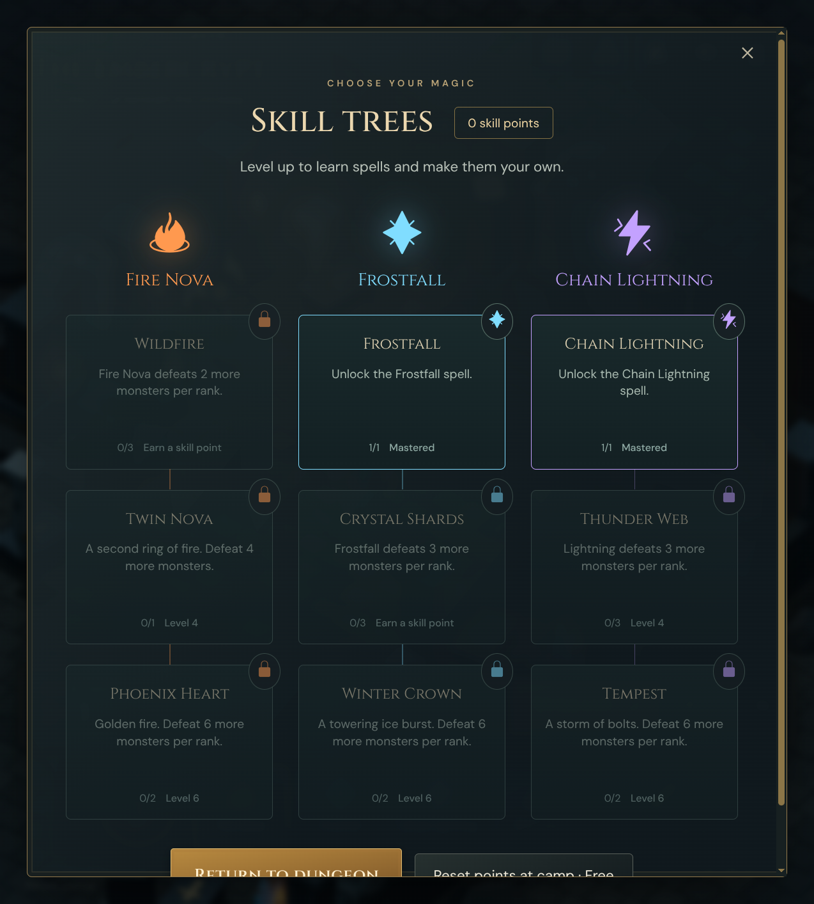

# The Sunken Vault playtest record

Verified September 5, 2026, using isolated learning fixtures and the user's Chromium profile through remote debugging on port 9222. These screenshots show the implemented game, not concept renders.

## Completed checks

- Production TypeScript check and Vite build passed.
- Server, shared, tooling, and client unit tests: **198 passed**, zero failures, 82,176 assertions.
- Two browser scenarios passed against a real offline tutor and fresh SQLite database: a complete expedition, wrong-answer retry, refresh/resume, boss loot, level-up, skill unlock, equipment changes, the next region, response recovery, worked help, touch input, and pause/save.
- One additional browser recovery scenario passed: dropped committed tutor/reward/skill/miss responses, reload during recovery, the exact adaptive next branch, preserved thinking time, demonstrations, assisted progress, and no duplicate XP, skill spending, or shield consumption.
- Live hardware Chromium playthrough: six encounters completed, 104 monsters defeated, 250 XP, level 3, rare boss loot, both new spells unlocked, and no page errors.
- The renderer's live hardware benchmark measured 60 FPS idle and 59–60 FPS through Fire Nova, Frostfall, and Chain Lightning; p95 frame time was approximately 17 ms. A spell resolves in about 2.35 seconds. These measurements apply to this machine, not all devices.
- Nine original Blender MCP models passed the asset validator. Models, eight original sounds, and licensed fonts are bundled locally.
- Phone layout checked at 390 × 844 with the number pad open; controls fit without horizontal overflow.

## Save and learning compatibility

The fixtures begin with existing mastered and practicing topics, reviews, demonstrations, gems, and equipment. Tests verify additive RPG initialization, unchanged legacy records, database reopen, profile isolation, and the real existing tutor attempt/retry/skip routes. RPG progression does not select math topics or change mastery rules. Production still uses profile `sam`; local testing uses separate profiles in a temporary database.

Ares was not changed or tested: its tailnet SSH policy denied access. Follow the [upgrade instructions](rpg-operations.md) using the current service working directory, database, environment, and proxy configuration. The code is ready for that deployment check, but this record is not evidence of a completed Ares upgrade.

## Practical limits

Headless Chromium using SwiftShader is slow at full visual quality on this machine. Browser fault tests lower its framebuffer resolution and disable shadows; the live hardware session tests full-quality rendering separately. Hardware acceleration is needed for the intended smooth presentation.

There are three replayable regions, three spells, nine skill nodes, and eight collectible items. This is a playable first release with a finite content collection; whether the progression is compelling to the child still needs his playtest.
