# Sunken Vault model library

These models were authored or adapted, UV-baked, exported, inspected, and revised with
**Blender MCP** connected to Blender 4.5.13 LTS, using the exact user prompt
**“use blender mcp to create high quality models.”** The wraith adapts an explicitly
CC0 creator-published lich foundation; its source, fixed hashes, license evidence,
and cache recovery are documented in [sources/cc0-lich](sources/cc0-lich/README.md).
Other runtime models retain their project-authored procedural sources.

The second revision responds to the approved [horde viewport](../../docs/concepts/math-dungeon-rpg/04-horde-viewport.png)
and [Fire Nova](../../docs/concepts/math-dungeon-rpg/05-fire-nova.png) concepts with
chipped Gothic masonry, carved capitals, layered armor, tailored cloth, anatomically
readable skeletons, hollow wraiths, and a fractured crystal guardian. The concept
images remain the visual target; these are realtime assets, not a reproduction of
the painted concept lighting or detail.

## Surfaces and runtime files

`web/public/assets/rpg/manifest.json` records current triangles, draw calls, nodes,
file sizes, and hero clips. All 22 GLBs are self-contained: embedded albedo,
tangent normal, and roughness/metallic textures (legacy kit materials also use AO); no external URLs or
compression decoder dependency. `imp.glb` aliases the skeleton for compatibility.

The Blender shaders generate stone grain, cracks, cloth weave, worn metal, bone,
and oak. UV baking preserves these surfaces in standard glTF materials. Source
maps are in `scripts/blender/textures`, outside the production public directory.
Runtime albedo atlases retain up to 1024 pixels (2048 for the authored wraith); normal and packed ORM maps use
512 pixels to limit aliasing and size.
Unused UV pixels are padded from their nearest valid surface across all three maps
before resizing, preventing black borders from bleeding into thin bones. Valid
source texels are preserved exactly. AO texture strength is .55 so cavities remain
legible under the game's low ambient light. Bone stains use restrained ivory/brown
contrast for legibility at horde scale. Bone and cloth are diffuse; armor alone
uses metalness. Emissive runes and
blade edges retain their own materials.

| Files | Authored content |
| --- | --- |
| `hero.glb` | Authored CC0 hooded warrior, fitted etched steel, quilted cloth, leather equipment and closed sword grip;19-joint rig |
| `hero-cinder.glb`, `hero-glacier.glb`, `hero-tempest.glb` | Progression armor silhouettes, matching rig and clips; transparent appearance portraits |
| `skeleton.glb`, `imp.glb` | Socketed skull, jaw and teeth, ribs, spine, paired limb bones, rusted armor |
| `revenant.glb` | Broad armored undead knight, broken left shield and long right blade; twelve rigid joints |
| `wraith.glb` | Layered CC0 robe/crown foundation, skull-like face, held staff; seven rigid joints |
| `guardian.glb` | Hunched granite body, oblique cleavage planes, sparse faults, sharp quartz clusters |
| `pillar.glb`, `arch.glb` | Chipped masonry, clustered columns, carved leaf capitals and pointed ribs |
| `wall.glb`, `wall-bay.glb`, `broken-wall.glb` | Irregular masonry, Gothic recess and grille, broken coping and rubble |
| `brazier.glb` | Sooty pedestal, hammered bowl, curled cage, glowing coals; runtime adds animated fire |
| `crystal.glb` | Irregular quartz growing through fractured host rock |
| `ice_cluster.glb` | Five irregular blue ice prisms, frosted fracture faces, and frozen footing |
| `chest.glb` | Weathered oak, corroded iron straps, carrying rings, hinged lid and glowing lock |
| `furnace.glb` | Open soot-lined kiln, radial stone lintel, cracked chimney, iron grate and banked coals |
| `reliquary.glb` | Carved octagonal plinth, four open Gothic arches, bronze cradle and crystal heart |

Coordinates are **+Y up, +Z front, meters, ground-centered origin**. The renderer
normalizes the model height for placement. Prefixes `Body_`, `Head_`, `Cape_`,
`Sword_`, `Lid_`, and `Embers_` identify meaningful parts; ignore numeric suffixes.
The default hero has 11 source mesh nodes with separate authored material sets; the older armor variants use four to six meshes, and the wraith uses seven. Articulated skeleton/guardian use thirteen
and sixteen respectively, shared in instanced batches. Major architecture generally
uses one.

## Hero animation

The default hero has 19 exact joints: `root`, `pelvis`, `chest`, `head`,
`cape`, `cape.mid`, `cape.hem`, and paired `arm`, `forearm`, `hand`, `leg`, `shin`,
`foot` joints. Connected armor retains rigid island weights, with flexible cloth
and three cape sections. The sword and blade are skinned to `hand.R`; the literal
`CastOrigin` attachment follows `hand.L`.

`idle` lasts 3.2 seconds, `walk` 0.8, and `cast`/`cleave` 1.1. All clips start at 0;
gather/release keys are 0.08/0.18 seconds. Horizontal root travel belongs to the
game. The rig authors sole grounding, so the runtime skips legacy body hops and
Cleave slides. Walk phase follows measured travel distance, with capped speed,
arrival braking and doorway waypoints. A rapid answer settles hero/camera into
the active encounter before attack timing, without delaying the next question.

Use `SkeletonUtils.clone` and `AnimationMixer`. The three older armor variants
retain their eight-bone rig and their original clip durations. Their geometry
and limits are independent of the new default hero.

The canonical default rebuild is `detailed/rebuild_authored_hero.py`; it composes
the reviewed source helpers under `experiments`, preserving authored UV sets and
material response. Restore the ignored licensed source using
`python scripts/blender/sources/cc0-hooded-warrior/fetch.py`. Source provenance,
fixed SHA and CC0 dedication live beside that script. No network/source cache is
needed to run the bundled game. The full independent rebuild reproduced all
geometry/animation payloads byte-for-byte and all 27 texture images pixel-for-pixel.

The packed default contains 62,593 triangles and is8,294,568 bytes; its scoped
budget is 65,000 triangles/9MB with exact19-joint hierarchy and clip validation.
Its appearance portrait is rendered from the actual packed GLB by
`detailed/render_authored_hero_portrait.py`.

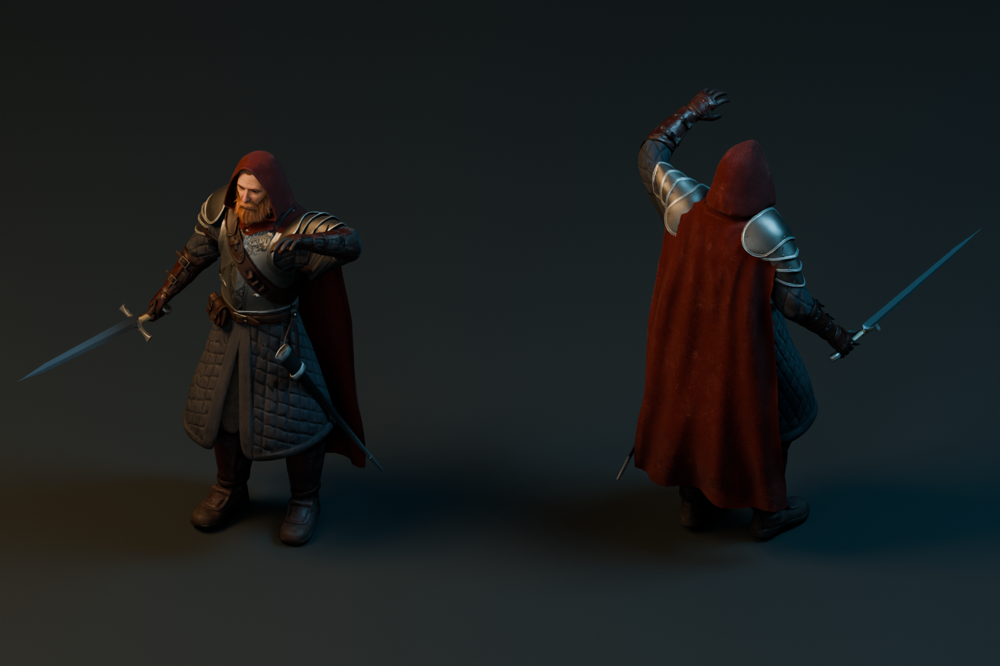
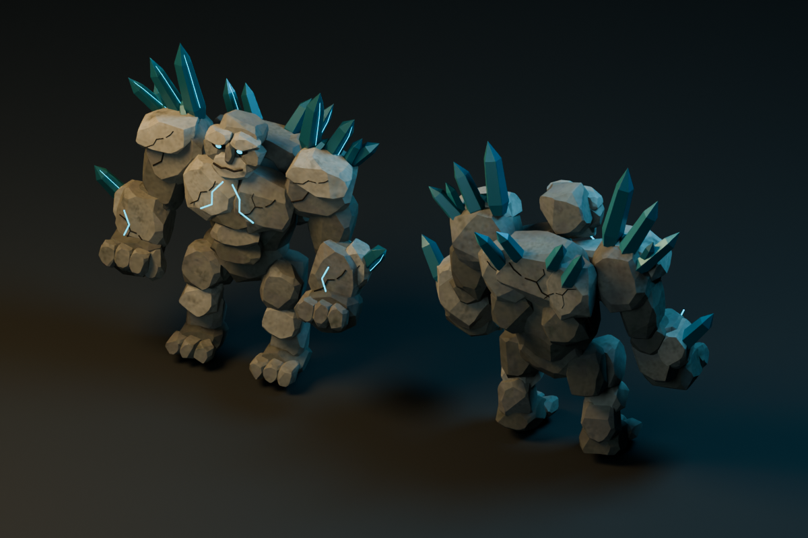

## Enemy articulation

Skeletons and guardians have ordinary `Joint_*` transform nodes: `Body`, `Head`,
paired `ArmUpper`, `ArmLower`, `LegUpper`, and `LegLower` joints. The skeleton also
has `Sword` and `Cape`. Stable `extras.enemyJoint` values identify each joint even
if Blender adds a numeric suffix to its name. Sword is parented to the right
forearm; elbows and knees inherit the upper limb transform. All bones and armor
pieces remain rigid, with their existing UVs and PBR surfaces.

`web/src/rpg/world/EnemyAnimator.ts` supplies cosmetic stance shifts, steps, head
motion, warning sweeps, recoil, and limb separation on defeat. It changes local
joint transforms only. The renderer retains travel/combat timing, calls the helper
before `updateMatrixWorld`, and copies source mesh matrices into shared instanced
batches. No per-enemy skinning, animation mixer, or cloned material is required.

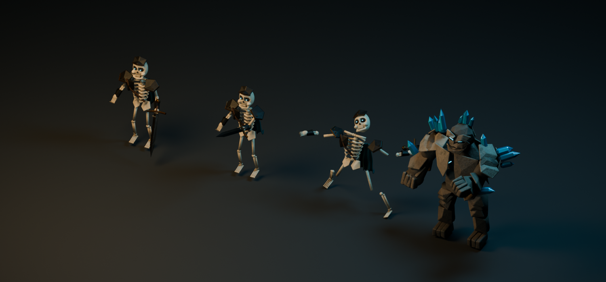

Studio renders use stronger fill for surface inspection; the game viewport remains
the final lighting check. Iteration corrected low ambient readability, excessive
occlusion, shadow acne on narrow skeleton bones, rigid casting, and toy-like stone
forms. Preview images from the first revision are retained only as history.

## Rebuild and validate

From the repository root, with Blender 4.5+, Python, Pillow, NumPy, and SciPy available:

```sh
blender --background --factory-startup --python scripts/blender/build_assets.py
python scripts/blender/validate_assets.py
```

The build creates a dedicated scene, preserves other scenes, uses seed 214 per
asset, bakes PBR maps, rigs the hero, articulates enemy parts, exports GLBs,
optimizes embedded textures, and
copies the skeleton compatibility alias. It requires no network. Validation checks
GLB structure, buffer bounds, embedded images, UV/material contracts, skin joints,
and the four animation names, then refreshes the manifest.

The masonry pass also bakes `detailed/bake_stone_surface.py` into
`web/public/assets/rpg/stone/`: seamless albedo, relief, and roughness maps made
with periodic four-dimensional noise. Runtime chipped blocks project these maps
at a consistent world scale; model atlases stay on their original UVs. The wall,
wall bay, and broken-wall exports use the wider stone courses and mineral-stained
materials in `detailed/architecture.py`. The full build refreshes both types of
surface. To rebake just the seamless maps, run Blender with
`--background --factory-startup --python scripts/blender/detailed/bake_stone_surface.py`.

For MCP execution, bind `__file__` to the absolute `build_assets.py` path before
executing it. The production MCP session used a dedicated virtual display and
`--factory-startup`; existing user scenes, settings, and learning data were preserved.
The `detailed/` helpers contain geometry, materials, baking, animation, optimization,
and review tools. The original helpers remain for reusable primitive construction
and chest topology.

The final guardian revision uses closed granite volumes with several real oblique
cuts per mass, narrow chipped edges, sparse branching faults, and subtle pitting.
Large uncracked faces retain its hunched body and heavy forearms. Uneven quartz
clusters use opaque mineral facets and narrow glints rather than emissive stripes.
The optimized GLB contains 24,570 triangles, sixteen rigid mesh parts, and three
embedded textures in 2,641,856 bytes. All ten joint pivots match the previous
articulated asset exactly. Guardian construction assigns explicit limb parts and stores authored
joint pivots on the collection; these survive baking and avoid centroid-based
misattachment. Older skeletal sources still use the centroid fallback. Soldier
limbs are thicker, with cupped shoulder caps, rounded helmets, and pitted armor.
The [exported creature review](previews/v2/creatures-rebuilt.png) was rendered after
re-importing the final optimized GLBs. Rebuilds retain the newly created
collection reference through baking and articulation, even when older workshop
scenes contain similarly named collections.

## Room landmarks

`detailed/landmarks.py` authors the Ember Hall furnace and Lost Reliquary shrine.
Both use seed 312 and the same bake/export/optimization pipeline as the existing
library. Their retained source atlases are under `textures/`. The final production
exports add 11,092 triangles and about 2 MB together.

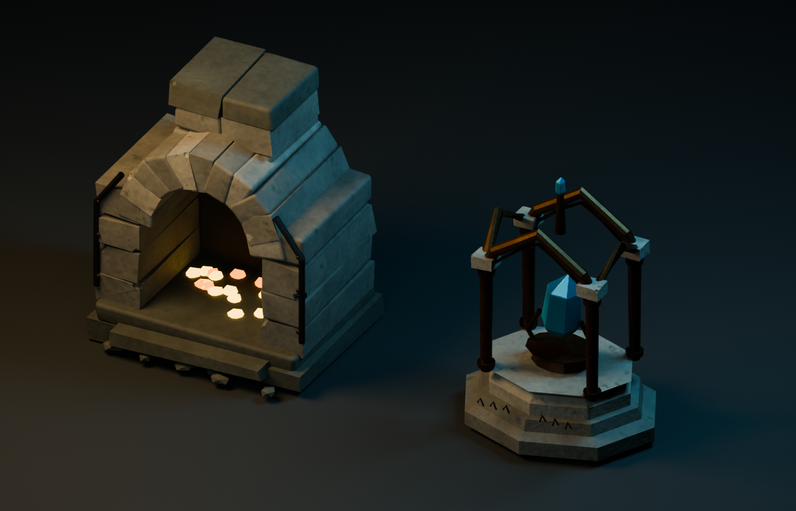

## Ice scenery and stone relief

`detailed/ice_cluster.py` builds a reusable scenery cluster with opaque dark blue
ice, oblique closed facets, limited frost, and sparse pale seams. It needs no
transparency sorting or emissive flood fill. The centered base is at ground level;
dimensions are 1.735 × 2.529 × 1.325 meters (width × height × depth). The optimized
GLB is 369,300 bytes, 1,380 triangles, one mesh, and three embedded 512-pixel maps.

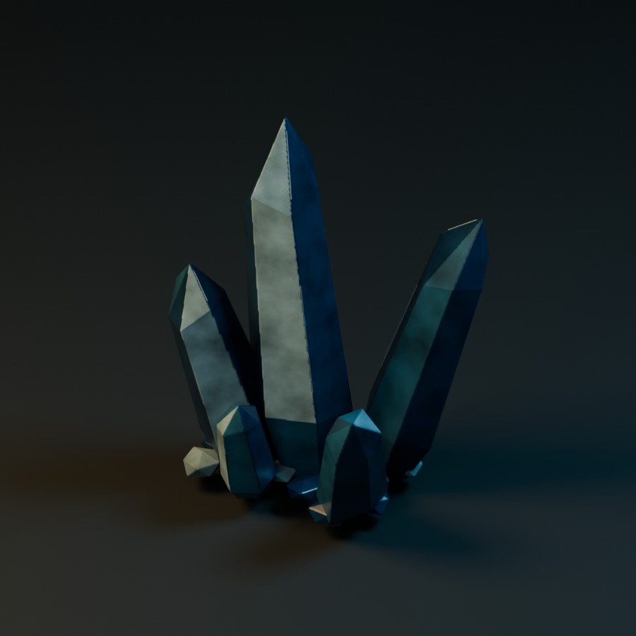

Seamless stone height combines .45 broad, .40 middle, and .15 fine noise, allowing
relief to remain visible at the gameplay camera distance. The stone bake helper
accepts `STONE_SURFACE_MAPS=('height',)` for a height-only MCP execution; its full
build default still creates all three maps. This pass preserved the existing stone
albedo and roughness files byte-for-byte.

The renderer places these outside the hero travel lane and enemy footprints, using
`web/src/rpg/world/roomLayout.ts`. Room widths, entrances, floor openings, and
formations are renderer metadata; they do not modify learning or saved expeditions.

## Baked wall relief

`erode_wall_faces` runs only on `wall-bay` and `broken-wall`. Existing stone
perimeters and ground bounds stay intact while irregular interior relief breaks
up large side and top faces. Copied wall materials add broad weathered normals;
other models and shared source materials are unaffected. Internal relief faces
share smooth vertex normals, preserving compact instanced geometry.

The two optimized GLBs total 68,621 triangles (12,448 above the previous revision)
and 4,496,120 bytes, with one draw call each. Full 1024-pixel albedo and 512-pixel
normal/ORM maps are retained. The validator enforces their combined size and
triangle budgets. Exported bounds match the prior models exactly.

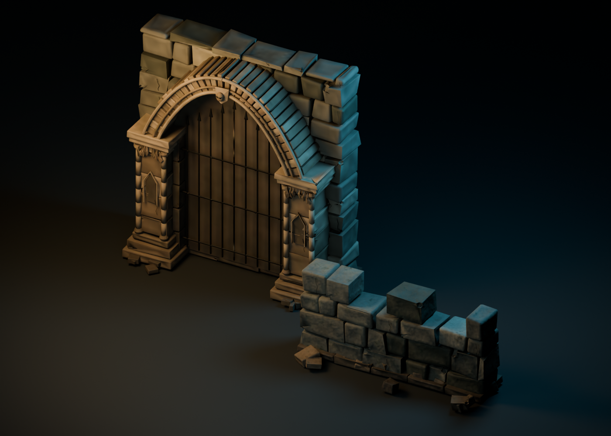


## Progression armor appearances

`detailed/hero_variants.py` builds three complete heroes on the original proportions:
Cinder (level 12) has forged angular pauldrons, amber fissures, and a shortened red
cloak; Glacier (level 15) adds layered frost plates, a cold steel cuirass, and a
navy cloak; Tempest (level 18) adds swept pauldrons, a hood crown, ornate chest
plates, and violet inlays. These are additional geometry and tailored cloth cuts,
not palette swaps. The default appearance uses the separately authored `hero.glb` described above.

Each variant uses the same eight bones (`root`, `chest`, `head`, `arm.L`, `arm.R`,
`leg.L`, `leg.R`, `cape`) and authored `idle`, `walk`, `cleave`, and `cast` clips.
The renderer retains control of travel; the clips have no root translation.
All four heroes normalize to the same runtime height and ground origin. New armor is posed before
baking and weighted as connected rigid pieces to avoid stretching armor panels.

The optimized variants contain 12,842 / 13,212 / 13,202 triangles, respectively,
and stay below 2.11 MB each. The complete library contains 22 GLBs, 347,940
triangles, and 45,072,840 bytes. The validator checks variant skins, clips,
embedded materials, portrait presence, and the 25,000-triangle / 4 MB budgets.

`detailed/render_appearances.py` reimports the final optimized GLBs into separate
Blender scenes and renders transparent 512 × 640 PNG portraits to
`web/public/assets/rpg/appearances/{cinder,glacier,tempest}.png`. Both model builds
and these final-file portraits run in the full `build_assets.py` pipeline. Source
atlases remain under `scripts/blender/textures/hero-{appearance}-*.png`.


## Revenant and reinforced skeleton

`detailed/revenant.py` builds a substantial undead knight from the common skeletal
anatomy: a dented enclosing cuirass, unequal layered pauldrons, a chipped iron-and-
oak shield, a long battered blade, an open broken helm, and ragged oxblood cloth.
Its exposed face stays recognizable and nongory. The source declares explicit
limb ownership and twelve ordinary joint pivots. The shield belongs to
`ArmLowerL`; `Sword` is parented under `ArmLowerR`. There are no skins, so all
thirteen mesh parts remain compatible with the shared instanced renderer.

The optimized revenant has 21,528 triangles and stays below 2.05 MB. This is
slightly above the initial 20,000-triangle target to retain the exposed anatomy,
layered shield, and cloth. Skeleton ribs and limb bones have more mass, with an
exposed sternum and chipped shoulder fragments; their foot size, ground height,
and head height are preserved. The skeleton now has 19,808 triangles. The `imp`
legacy path remains an exact copy of the updated skeleton GLB.

Both use padded embedded albedo, normal, and ORM maps. Full rebuilding includes
the revenant and its articulation; validation checks joint metadata, embedded
textures, its right-hand sword parent, and the export budget. Source maps remain
in `scripts/blender/textures/` rather than the runtime public tree.

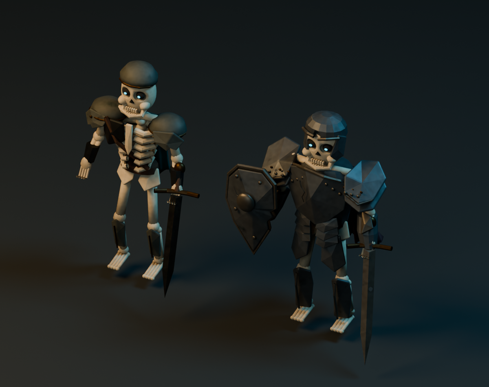


## Guardian granite surface revision

The guardian now uses a dedicated dark granite shader with broad warm mineral
variation, sparse feldspar flecks, coarse normal detail, and roughness breakup.
A restrained contact-dirt multiplier is baked into its albedo, preserving visible
recesses under the game's direct lights when small actor meshes do not receive
shadow maps. The separate ORM red channel still contains physical ambient
occlusion; the audit found valid AO and correct color spaces in the prior export,
not a missing-map or gamma error. Normal and roughness detail is authored at a
larger scale to survive the gameplay camera distance. Icy seams and quartz
geometry remain unchanged.

`guardian_granite_materials` in `detailed/characters.py` owns this shader, and
`make_guardian_v2` restores its material dictionary after construction so later
assets cannot inherit guardian-specific granite during a full rebuild. No shared
bake or optimization settings changed. Both before/after exports have identical
45,436 vertex positions, 24,570 triangles, sixteen mesh parts, bounds, and ten
joint pivots/hierarchy. The optimized replacement is 2,641,856 bytes.

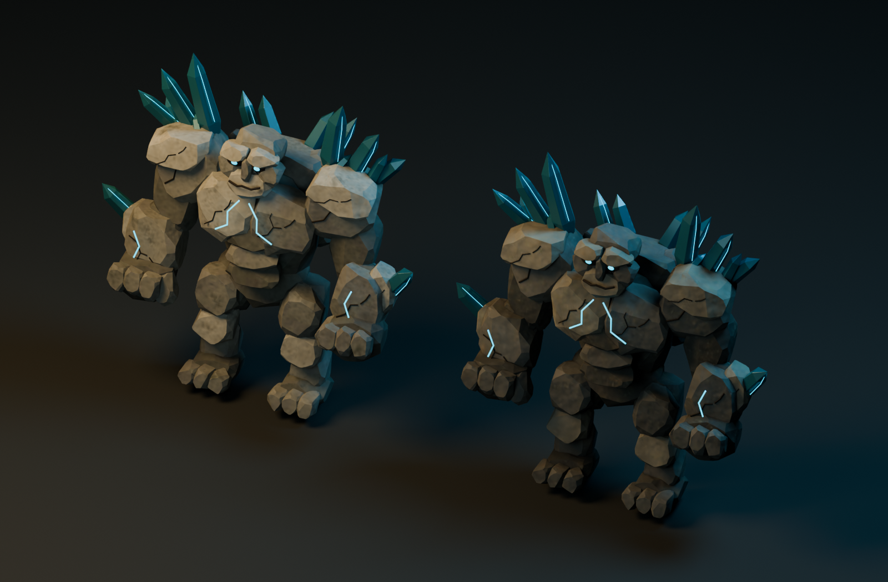


## CC0 wraith foundation and rigid articulation

The current wraith preserves a layered robe, crown, skull-like face and held staff
from a creator-published CC0 Meshy foundation, with coherent cloth normals,
restrained teal coloring, matte roughness breakup and a UV-preserving Blender bake.
A localized monotonic Body/Cape value curve reveals broad dark cloth folds in the
dungeon while preserving deep recesses and bright trim.
The exact source is pinned to commit `463aed23d879ea673600bd1121fd0989a518599b`;
its SHA-256 is `049979a83aca55358f54af8d3af1f7d518607bef634474a4ef015bfdff947a42`.
Credit: Lich foundation created and animated with Meshy, shared CC0 by
Samfa12-tech; adapted for Embercrypt. No generation service is required to run it.

`detailed/wraith_cc0.py` is the canonical builder. Restore a missing ignored
source cache with `python scripts/blender/sources/cc0-lich/fetch.py` before a
full Blender rebuild. The builder checks its fixed hash and explicitly fails
if it is missing or altered; it never falls back to a rejected procedural model.
The shipped GLB embeds everything needed at runtime.

The optimized model is 2,061,908 bytes with 9,188 triangles, seven rigid mesh parts
and seven joints:
Body, Head, Cape, ArmUpperL/R and ArmLowerL/R. Forearms parent to upper arms;
head, cape and shoulders parent to Body. The staff is ordinary geometry in
the holding ArmLowerL mesh, so it cannot distort with biped leg/skin weights.
There are no skins, clips or artificial leg joints. Keep motion restrained to
preserve the rigid garment overlaps. The previous exact vertical bounds
0.06131713–1.93340003 meters are retained; width is 1.294m including the staff.

The authored UVs retain a 2048px albedo; normal and ORM maps are packed at 512px.
The full build honors the wraith's UV/atlas/specular metadata, then adds the
rigid hierarchy. The manifest records final byte counts and provenance; the
validator verifies all seven joints and that the staff follows its forearm.

The final GLB reimport and a moderate reaching pose each passed independent
8/10 asset review. Native-camera warm/cool room readability also passed 8/10 at
the renderer's 1.85m presentation height. These are scoped visual reviews, not an
assertion that every animation or the whole game meets that grade. Source/clay studies and rejected experiments remain isolated
under `experiments`, with their limitations recorded rather than called finished.

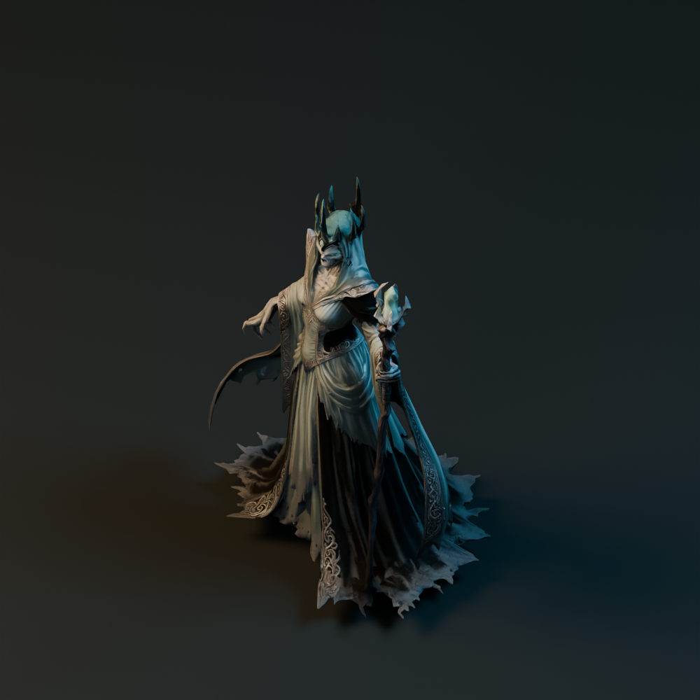

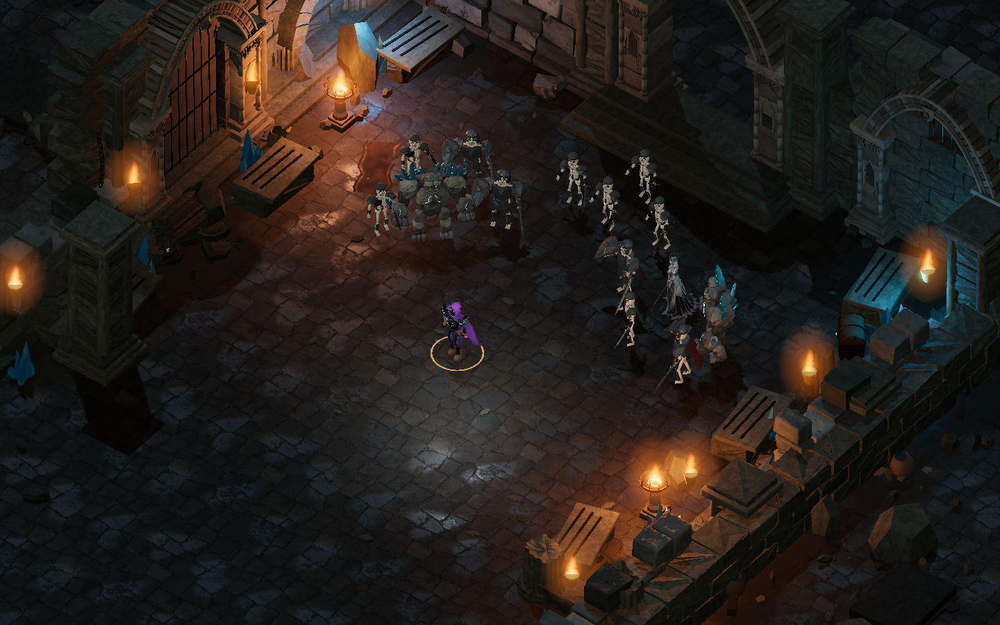

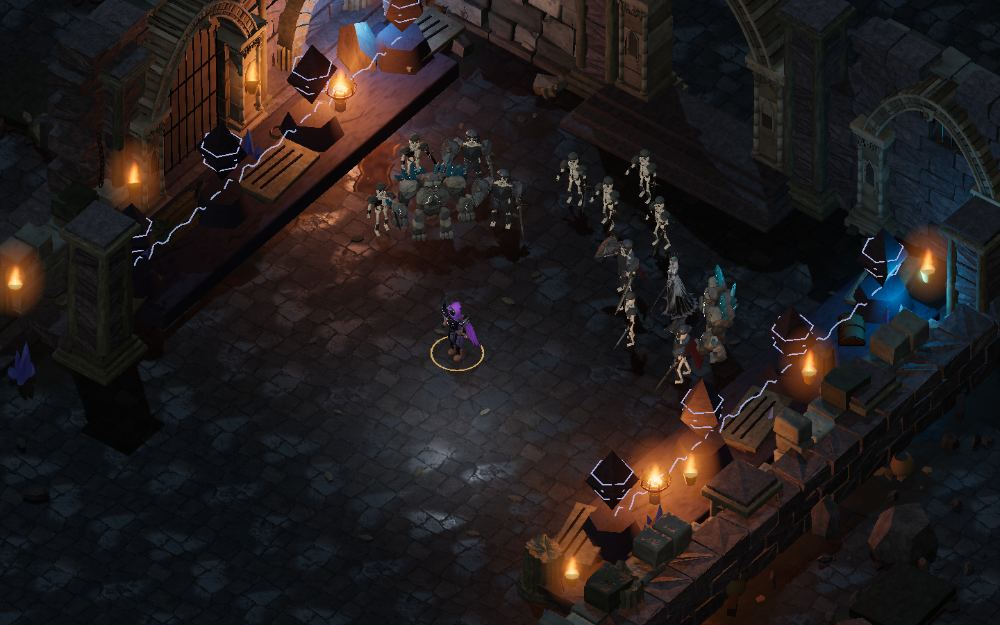
