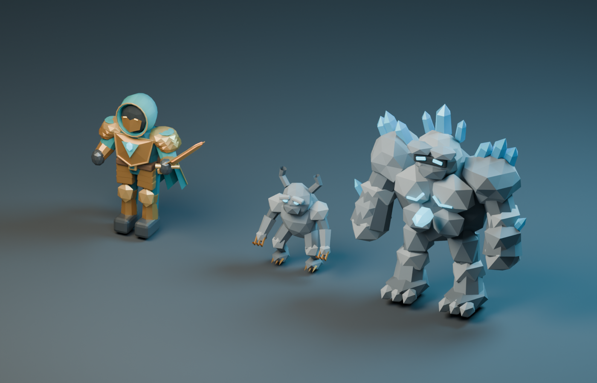
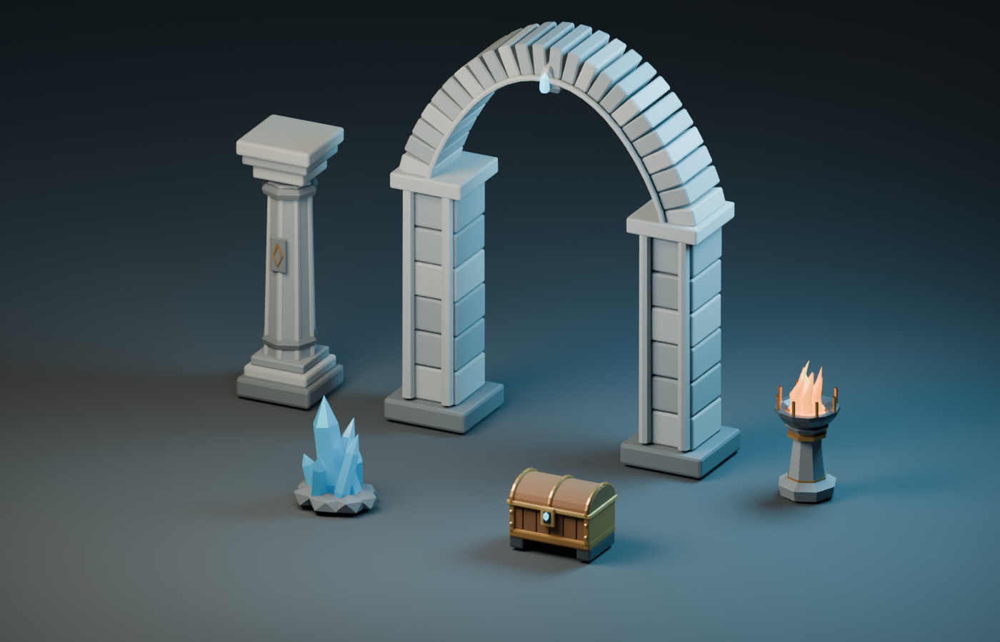

# Sunken Vault original model library

These nine original assets were modeled, exported, rendered, inspected, and revised
using **Blender MCP** connected to Blender 4.5.13 LTS. No downloaded models or paid
generation services were used. The exact user prompt attached to all MCP operations
was: **“use blender mcp to create high quality models.”**

The design follows the approved [horde viewport](../../docs/concepts/math-dungeon-rpg/04-horde-viewport.png)
and [Fire Nova concept](../../docs/concepts/math-dungeon-rpg/05-fire-nova.png): a teal
hood and cape, layered bronze armor, an amber runeblade, stone creatures with cyan
eyes and crystal growths, Gothic arches, fluted pillars, iron braziers, and banded
treasure chests. The models deliberately use strong sculpted silhouettes and
faceted stone with PBR vertex colors to remain readable at the pulled-back camera.

## Preview renders




The studio renders use brighter neutral fill than the game for surface inspection.
Iterations corrected sword foreshortening, smoothed the cloth hood, removed an
unintended emissive cape, and preserved cyan/amber emission hues through glTF export.

## Files and integration

All runtime files are in `web/public/assets/rpg/`; `manifest.json` lists sizes,
triangle counts, draw calls, and actual node names. Models are GLB 2.0 with no
external textures, no Draco dependency, no external URLs, and no skeletal rigs.
Exported coordinates: **+Y up, +Z front, meters, origin at ground center**.

| File | Approximate height | Purpose |
| --- | ---: | --- |
| `hero.glb` | 1.86 m | Hooded adventurer, layered armor, sword and folded cape |
| `imp.glb` | 1.25 m | Hunched horned stone imp with articulated-looking limbs |
| `guardian.glb` | 2.66 m | Crystal-crowned guardian with fractured stone plates |
| `pillar.glb` | 3.20 m | Fluted octagonal column with carved rune inset |
| `arch.glb` | 4.90 m | Pointed arch with individual voussoirs and colonettes |
| `brazier.glb` | 1.64 m | Iron crown bowl with asymmetric flame tongues |
| `crystal.glb` | 1.35 m | Hexagonal crystal cluster in rubble |
| `chest.glb` | 0.82 m | Oak planks, barrel lid, rivets, enchanted lock |
| `wall.glb` | 2.47 m | 4.1 m wide staggered masonry wall |

Node prefixes `Body_`, `Head_`, `Cape_`, `Sword_`, `Flame_`, and `Lid_` allow
procedural presentation animation. Suffixes may contain Blender uniqueness numbers;
match prefixes. All exported mesh transforms are applied; pivots remain at ground
origin. For joint rotation, reparent to a runtime pivot: the hero sword grip is
approximately `(0.49, 1.06, 0.22)` and the chest rear hinge `(0, 0.57, -0.345)`.
Whole-character squash, sway, turns, dashes and knockback need no rig.

Meshes are merged by body part and PBR family. The imp and guardian need five draw
calls each; the hero needs eleven. Share geometry and materials between instances.
Emissive materials preserve their hues in glTF and can drive bloom if enabled.

## Rebuild and validate

From the repository root:

```sh
blender --background --factory-startup --python scripts/blender/build_assets.py
python scripts/blender/validate_assets.py
```

For MCP rebuilding, execute `build_assets.py` with `__file__` bound to its absolute
path inside an isolated Blender scene. Helpers use seed 214 for repeatable weathering.
`preview.py` creates independent studio scenes without mutating source models.

The original MCP connection was started in a dedicated virtual display because no
Blender process was running. Existing user scenes, settings, and learning data were
not altered. Scripts and runtime assets are the editable source of truth; an opaque
`.blend` binary is unnecessary for rebuilding these procedural authored models.
