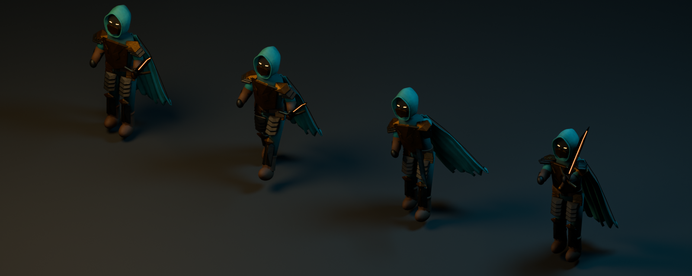
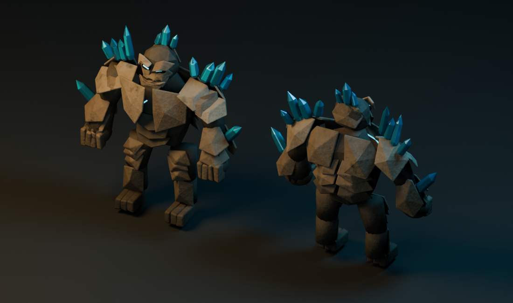

# Sunken Vault original model library

These original models were built, UV-baked, exported, inspected, and revised with
**Blender MCP** connected to Blender 4.5.13 LTS, using the exact user prompt
**“use blender mcp to create high quality models.”** No downloaded models or
third-party textures are included. The procedural Blender sources are reproducible.

The second revision responds to the approved [horde viewport](../../docs/concepts/math-dungeon-rpg/04-horde-viewport.png)
and [Fire Nova](../../docs/concepts/math-dungeon-rpg/05-fire-nova.png) concepts with
chipped Gothic masonry, carved capitals, layered armor, tailored cloth, anatomically
readable skeletons, hollow wraiths, and a fractured crystal guardian. The concept
images remain the visual target; these are realtime assets, not a reproduction of
the painted concept lighting or detail.

## Surfaces and runtime files

`web/public/assets/rpg/manifest.json` records current triangles, draw calls, nodes,
file sizes, and hero clips. All thirteen GLBs are self-contained: embedded albedo,
tangent normal, and occlusion/roughness/metallic textures; no external URLs or
compression decoder dependency. `imp.glb` aliases the skeleton for compatibility.

The Blender shaders generate stone grain, cracks, cloth weave, worn metal, bone,
and oak. UV baking preserves these surfaces in standard glTF materials. Source
maps are in `scripts/blender/textures`, outside the production public directory.
Runtime albedo atlases retain up to 1024 pixels; normal and packed ORM maps use
512 pixels to limit aliasing and size.
Unused UV pixels are padded from their nearest valid surface across all three maps
before resizing, preventing black borders from bleeding into thin bones. Valid
source texels are preserved exactly. AO texture strength is .55 so cavities remain
legible under the game's low ambient light. Bone stains use restrained ivory/brown
contrast for legibility at horde scale. Bone and cloth are diffuse; armor alone
uses metalness. Emissive runes and
blade edges retain their own materials.

| Files | Authored content |
| --- | --- |
| `hero.glb` | Teal hood and folded cape, layered bronze armor, runeblade; eight-bone rig |
| `skeleton.glb`, `imp.glb` | Socketed skull, jaw and teeth, ribs, spine, paired limb bones, rusted armor |
| `wraith.glb` | Hollow hood, torn hanging robe, curved sleeves and skeletal casting hands |
| `guardian.glb` | Rough stone cranium, recessed eyes, asymmetric slabs and crystal growths |
| `pillar.glb`, `arch.glb` | Chipped masonry, clustered columns, carved leaf capitals and pointed ribs |
| `wall.glb`, `wall-bay.glb`, `broken-wall.glb` | Irregular masonry, Gothic recess and grille, broken coping and rubble |
| `brazier.glb` | Sooty pedestal, hammered bowl, curled cage, glowing coals; runtime adds animated fire |
| `crystal.glb` | Irregular quartz growing through fractured host rock |
| `chest.glb` | Weathered oak, corroded iron straps, carrying rings, hinged lid and glowing lock |

Coordinates are **+Y up, +Z front, meters, ground-centered origin**. The renderer
normalizes the model height for placement. Prefixes `Body_`, `Head_`, `Cape_`,
`Sword_`, `Lid_`, and `Embers_` identify meaningful parts; ignore numeric suffixes.
Actors use four to six meshes; major architecture generally uses one.

## Hero animation

The hero has eight bones: `root`, `chest`, `head`, `arm.L`, `arm.R`, `leg.L`,
`leg.R`, and `cape`. Connected armor pieces receive rigid island weights; the cloak
blends between chest and cape. Sword meshes remain separate but are skinned to
`arm.R`, allowing independent equipment emission.

`idle` (3.2 seconds) and `walk` (.8 seconds) loop. `cleave` and `cast` (1.13 seconds)
are single actions with a windup, strike/release, and recovery. Root translation
stays zero; the game owns movement. Use `SkeletonUtils.clone` for the hero,
`AnimationMixer`, and a short crossfade. The enemy models remain rigid for efficient
instancing. This is a small authored rig, not a full anatomical animation system.




Studio renders use stronger fill for surface inspection; the game viewport remains
the final lighting check. Iteration corrected low ambient readability, excessive
occlusion, shadow acne on narrow skeleton bones, rigid casting, and toy-like stone
forms. Preview images from the first revision are retained only as history.

## Rebuild and validate

From the repository root, with Blender 4.5+, Python, Pillow, NumPy, and SciPy available:

```sh
blender --background --factory-startup --python scripts/blender/build_assets.py
python scripts/blender/validate_assets.py
```

The build creates a dedicated scene, preserves other scenes, uses seed 214 per
asset, bakes PBR maps, rigs the hero, exports GLBs, optimizes embedded textures, and
copies the skeleton compatibility alias. It requires no network. Validation checks
GLB structure, buffer bounds, embedded images, UV/material contracts, skin joints,
and the four animation names, then refreshes the manifest.

For MCP execution, bind `__file__` to the absolute `build_assets.py` path before
executing it. The production MCP session used a dedicated virtual display and
`--factory-startup`; existing user scenes, settings, and learning data were preserved.
The `detailed/` helpers contain geometry, materials, baking, animation, optimization,
and review tools. The original helpers remain for reusable primitive construction
and chest topology.
